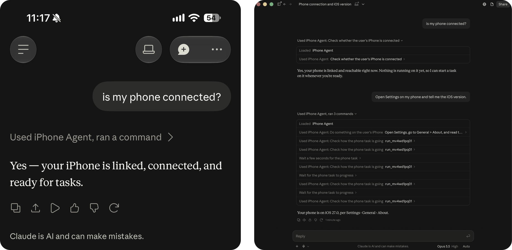

# Phone Control

### Ask Claude to do something on your iPhone, and it happens on the real phone.

From the Claude app, from anywhere. No Mac, no cable, no app of ours to keep open.

[How it works](#how-it-works) · [How the AI drives the phone](#how-the-ai-drives-the-phone) · [Results](#results) · [Set it up](#set-it-up) · [Tests](#tests)

<!-- A screen recording of a task running on the phone goes here. -->

  

Phone Control is a server you run yourself, for your own iPhone. You add it to Claude as a custom connector. When you ask for something to be done on your phone, the server starts an automation session on the phone over your VPN, an AI agent looks at the screen and taps, types and swipes until the job is done, and the answer comes back to your chat.

> **Where this comes from.** This continues [Agentic Automation on iOS](https://github.com/bryanrg22/ios-agent_automation_info), which took 3rd place at the Claude Builder Hackathon at UCLA. That version drove the iPhone from a Mac it was plugged into and needed its own app on the phone. This one needs neither: a small Linux server drives the phone over the network, and Claude's own app is the interface.

## What you can ask

- *"Is my phone connected?"*
- *"Open Settings and tell me which iOS version I'm on."*
- *"Open Messages and read me the last thing Sam sent."*
- *"Use Sonnet for this one: open Maps and find the nearest coffee shop."*
- *"From now on use Decisions."* (the [hybrid agent](#how-the-ai-drives-the-phone))
- *"Stop."*

The agent can use any app on the phone, because it operates the phone the way a person does: it looks at the screen and touches it.

## How it works

1. You ask Claude to do something on your phone. Claude calls the `run_phone_task` tool on your server and immediately gets a run id back.
2. The server starts automation on the phone, checks it is unlocked, and swipes away another app's banner if one covers the top of the screen.
3. The agent loops: read the screen, decide the next action, do it.
4. Claude keeps asking how the task is going. Each check waits on the server for up to ten seconds, so progress shows up promptly.
5. When the agent is done, the server brings the Claude app back to the front, ends the automation session, and the answer appears in your chat.

## How the AI drives the phone

Each step, the agent reads the screen (a screenshot, plus the list of on-screen elements from iOS's accessibility tree), chooses one action, and does it. Three kinds of model can do the choosing:

**An LLM** (GPT, Claude or Gemini) sees the screenshot and the element list and writes the next action as a tool call, like `tapText("Save")` or `inputText("Gym")`. It is the most capable chooser and the slowest.

**A decision model** ([TypeSafe's Jev](https://typesafe.ai), [OpenAI's Decisions API](https://platform.openai.com)) cannot write anything. It answers a multiple-choice question with a probability for each option. So the agent turns the screen into a menu: one option per element to tap, one per phrase from the task to type into each field, plus scroll, go back, open an app, done and blocked. The model picks one and the agent carries it out. This is fast and cheap, but on its own it passes 2 of 27 tasks: it cannot write free text, and it repeats taps that do nothing.

**The hybrid** lets each do what it is good at. The decision model chooses, and the LLM takes over when the decision model:

- picks *done* or *blocked* (the LLM checks the screen and writes the answer),
- needs to type something,
- is unsure (its best option is below 50% probability), or
- is stuck (the screen has not changed for 3 steps).

In the **sticky** version, once the LLM takes over it keeps control until it hands back with a `handBack` tool, finishes, or has taken 5 steps in a row. That stopped the two models from undoing each other's plans, and cut the decision calls by 60%.

Say which one to use in the chat:

| Say | What drives the phone | Needs |
| --- | --- | --- |
| "Luna", "Sol", "Sonnet", "Opus", "Gemini", … | That LLM alone | That provider's API key |
| "Decisions" | Hybrid: OpenAI's Decisions API + GPT-6 Luna, sticky | `OPENAI_API_KEY` |
| "Jev" | Hybrid: TypeSafe's Jev + GPT-6 Luna, sticky | `OPENAI_API_KEY`, `TYPESAFE_API_KEY` |

The model that drives the phone is separate from the model you chat with, and can be set per task or as your default.

## Results

Measured on [iOSWorld](https://github.com/ljang0/iOSWorld)'s 27 single-app tasks, a public benchmark of iPhone tasks run in the iOS Simulator and graded by its own judge, with every judged pass then checked by hand against the screens and the apps' saved data:

| Agent | Trials | Tasks completed (95% interval) | Every trial | Wall time / task | Cost / task | Input tokens / task | Output tokens / task |
| --- | :---: | :---: | :---: | :---: | :---: | :---: | :---: |
| **GPT-6 Luna alone** | 3 | **69%** (54–83%) | 15 / 27 | 65 s | $0.0083 | 172k (63% cached) | 1.8k |
| Hybrid, sticky (Decisions + Luna) | 3 | 65% (51–79%) | 13 / 27 | **53 s** | $0.0075 | 150k (61% cached) | 1.5k |
| Hybrid, sticky (Jev + Luna) | 3 | 54% (40–69%) | 9 / 27 | 53 s | $0.0069 | 158k (60% cached) | 4.3k |
| OpenAI Decisions API alone | 1 | 0% (0–12%) | – | 45 s | $0.0049 | 49k | 0 |
| Jev alone | 1 | 0% (0–12%) | – | 25 s | $0.0025 | 58k | 6.6k |

Luna alone and the Decisions hybrid are not significantly different (paired test, p = 0.65); the hybrid is about a fifth faster and 10% cheaper a task. It is not yet safe to let it spend money: in every run of the payment task, it sent the transfer twice without asking, where Luna alone asked first. The judge's verdicts alone would have put the hybrid ahead: 20% of judged passes did not hold up when checked, more of the hybrid's than of Luna's. **[docs/results.md](docs/results.md)** has the method, every agent tried, per-task results, how the tests themselves were checked, and how sure each comparison is.

## Why each piece exists

Apple's UI automation is built for a phone plugged into a Mac running Xcode. Each part of this project removes one piece of that assumption.

**A server, because Claude calls tools from the cloud.** Claude's tool calls come from Anthropic's servers, not from your phone, so something must be reachable on the public internet over HTTPS. Tailscale Funnel gives your server that address without opening anything else.

**Tailscale, because the phone moves.** The server needs to reach the phone at home, at work and on cellular. With Tailscale on both, the phone keeps one address on every network.

**A tunnel, because iOS's developer services only exist inside one.** [`device/tunnel.py`](device/tunnel.py) builds the encrypted CoreDevice tunnel to the phone's VPN address with [pymobiledevice3](https://github.com/doronz88/pymobiledevice3). iOS only accepts a *new* tunnel while the phone is on Wi-Fi, but an existing one keeps working on cellular.

**A patched go-ios, because the session assumes a cable.** [go-ios](https://github.com/danielpaulus/go-ios) starts the XCTest session, but first insists on finding the phone over USB. [A patch](device/patches/go-ios-cableout.patch) removes that assumption ([details](docs/architecture.md#how-a-session-reaches-an-unplugged-phone)).

**A runner, because something on the phone has to do the tapping.** [`runner/`](runner/) is an XCTest app, derived from [Maestro](https://github.com/mobile-dev-inc/Maestro)'s, that taps, types, swipes and takes screenshots on request. While it runs, iOS shows an "Automation Running" banner, so the server ends the session after every task and keeps only the tunnel warm.

[docs/architecture.md](docs/architecture.md) goes deeper: warm and cold starts, the developer disk image, sign-in, and how the server tells Wi-Fi, cellular, locked and unreachable apart.

## What you need

- An iPhone you own, on iOS 17 or later (built and tested on an iPhone 15 Pro with iOS 27), and an Apple developer account (a free one works, but its signing lasts 7 days).
- A Mac with Xcode, once, to build the runner and pair the phone.
- A small Linux server that stays on. A $6/month VPS is enough.
- A [Tailscale](https://tailscale.com) account, with the phone and the server on it.
- An API key for the model that drives the phone: OpenAI, Anthropic or Google, plus TypeSafe for the Jev hybrid.

## Set it up

1. **[Set up the server](docs/install-server.md)**: dependencies, this repository, the service, a public HTTPS address.
2. **[Set up the phone](docs/install-phone.md)**: build and install the runner, pair the phone with your server, first start.
3. **[Connect Claude](docs/connect-claude.md)**: add the custom connector and enter a one-time connect code.

Then, in the Claude app: *"Is my phone connected?"*

## What to expect

- **The phone must be unlocked** when a task starts. After a restart, iOS asks once for the passcode to allow automation (right).
- **Wi-Fi to start, not to continue.** The first task after the phone has been idle for a while needs Wi-Fi. While the connection stays warm, later tasks also work on cellular.
- **Asking never touches the phone.** "Is my phone connected?" only looks.
- **Stopping**: say *stop* in the chat, or hold both volume buttons on the phone (instant). The Stop button in the Claude app also ends the task, within 30 seconds.
- **Every state has its own answer.** Locked, on cellular, unreachable, restarted, waiting for the passcode: the server tells Claude which, and what to do. [docs/operations.md](docs/operations.md) lists them.
- **The connector's icon will be Tailscale's** if your server uses a Tailscale address. [Why, and how to change it](docs/connect-claude.md#the-connectors-icon).

 

## Status

| | |
| --- | --- |
| The whole path, Claude app → server → iPhone → answer | Working on an iPhone 15 Pro (iOS 27) driven from a 1 GB Ubuntu 24.04 server |
| The agent on a benchmark | [Measured on iOSWorld](docs/results.md) in the iOS Simulator |
| The hybrid agents on the real phone | Deployed and choosable from the chat; not yet measured there |
| Tests without a phone | Unit, simulated-phone lifecycle, whole-path and MCP conformance tests, in CI on every push |
| The setup guides | Written from a working setup; not yet followed start to finish on a fresh machine |
| Limits on what the agent may do | None. It can do anything you could do by tapping. Use it on your own phone, and read [SECURITY.md](SECURITY.md) |

## Tests

Two kinds: **tests** that check the code does what it should, and **evals** that measure how well the AI does the job.

| Command | What it checks | Needs |
| --- | --- | --- |
| `npm test` | Server, agent and eval-harness unit tests (about 600 checks), against fake phones and fake model APIs | Nothing |
| `npm run test:lifecycle` | The real device code against a simulated phone: Wi-Fi and cellular, lock, restart, the passcode prompt (~4 min) | Nothing |
| `npm run test:e2e` | The real server and device code end to end, simulated phone, stand-in model | Nothing |
| `npm run test:conformance` | The MCP server against the official MCP conformance suite | Nothing |
| `npm run lint` | ESLint | Nothing |
| `npm run evals:phone-agent` | The agent on [iOSWorld](https://github.com/ljang0/iOSWorld)'s tasks in the iOS Simulator, graded by iOSWorld's judge ([results](docs/results.md)) | A Mac, a simulator, model keys |
| `npm run evals:connector` | How well the assistant you chat with uses this server's tools, graded by a judge from another company ([results](evals/baselines/connector/)) | Model keys |

CI runs the first five on every push, plus a build of the runner. `npm run test:record` runs every test and files the results under the version tested, in [test-results/](test-results/). [docs/development.md](docs/development.md) says what the simulated phone covers and what it does not.

## Repository layout

| Directory | What it is |
| --- | --- |
| [`server/`](server/) | The MCP server: sign-in (OAuth 2.1), the tools Claude calls, which model drives the phone, the task lifecycle |
| [`device/`](device/) | Everything the server does *to* the phone: tunnel, session start and stop, lock and network state |
| [`agent/`](agent/) | The loop that drives the phone, with every kind of model: LLMs, decision models, hybrids |
| [`runner/`](runner/) | The XCTest app on the iPhone that performs the taps (derived from Maestro, Apache-2.0) |
| [`evals/`](evals/) | The iOSWorld harness, the connector evals, and every filed result |
| [`deploy/`](deploy/) | systemd unit, settings templates, pinned Python requirements |
| [`e2e/`](e2e/) | The whole path against a simulated phone, and a guided check for a real one |
| [`docs/`](docs/) | Architecture, setup, operations, development, results |

## Third-party code

- `runner/` is derived from [Maestro](https://github.com/mobile-dev-inc/Maestro)'s iOS XCTest runner (Apache-2.0); [runner/README.md](runner/README.md) lists the changes.
- `device/patches/go-ios-cableout.patch` is a patch against [go-ios](https://github.com/danielpaulus/go-ios) (MIT), which `scripts/build-go-ios.sh` fetches and builds.
- `device/tunnel.py` uses [pymobiledevice3](https://github.com/doronz88/pymobiledevice3) (GPL-3.0), installed separately and not included here.
- The agent is evaluated on [iOSWorld](https://github.com/ljang0/iOSWorld), which is not included here.

## License

[MIT](LICENSE), except `runner/`, which keeps Maestro's Apache-2.0 license.
