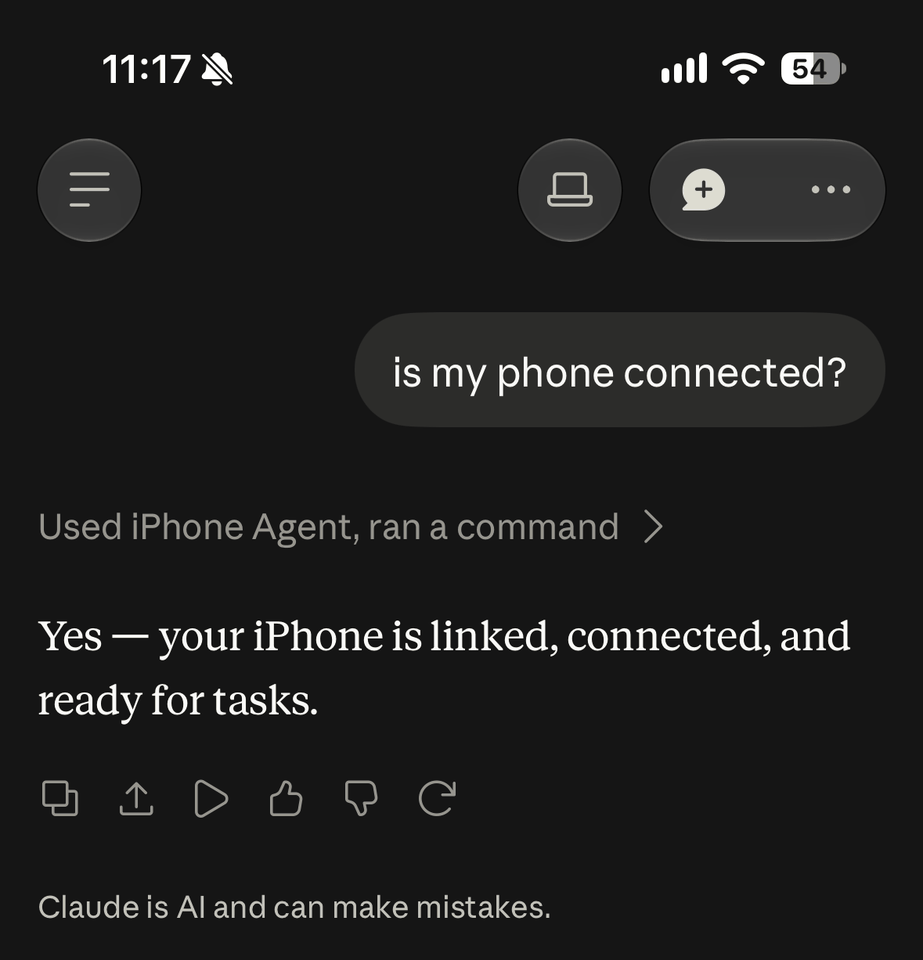
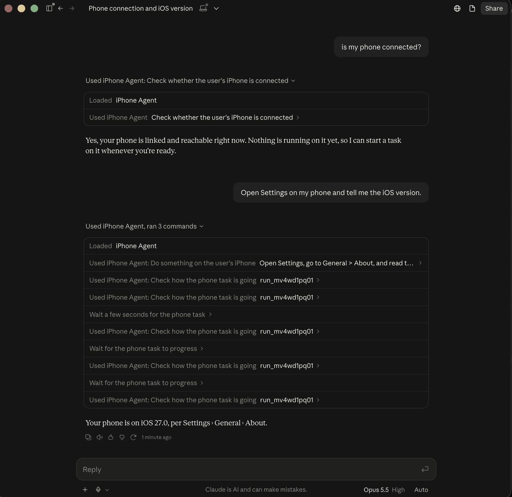
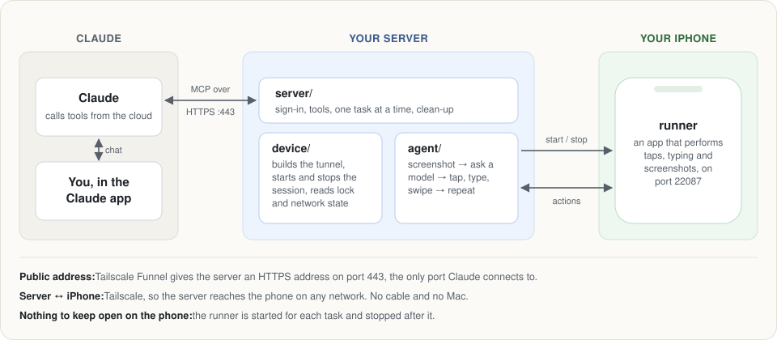
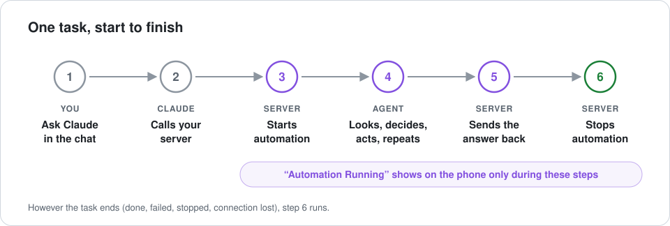
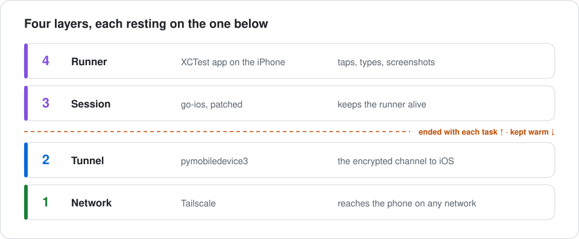
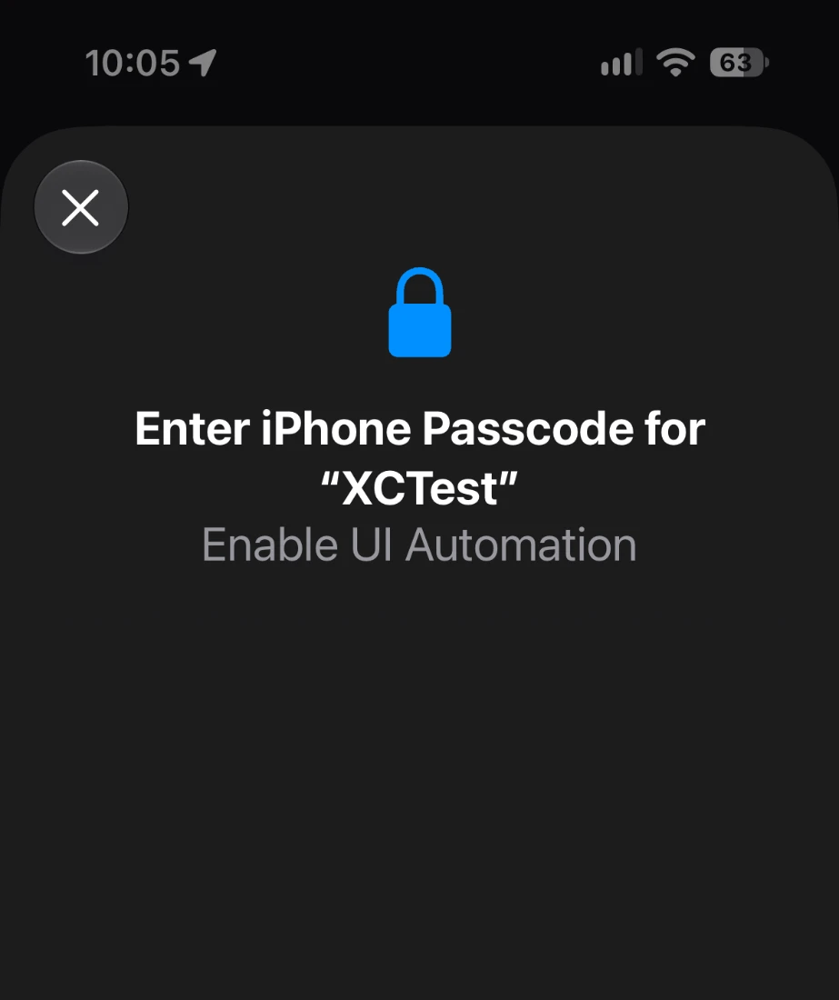
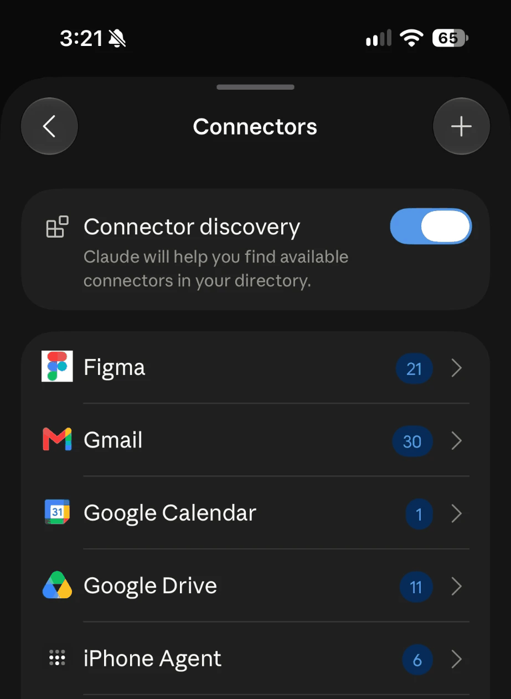

# Phone Control

**Ask Claude to do something on your iPhone, and it happens on the real phone.** From the Claude app, from anywhere, with no Mac, no cable and no app of ours to keep open.

<p align="center">
  
  &nbsp;&nbsp;
  
</p>

Phone Control is a server you run yourself, for your own phone. You add it to Claude as a custom connector. When you ask for something to be done on your phone, the server starts an automation session on the phone over your VPN, an agent looks at the screen and taps, types and swipes until the job is done, the answer comes back to your chat, and the session ends.

> **Where this comes from.** This continues [Agentic Automation on iOS](https://github.com/bryanrg22/ios-agent_automation_info), which took 3rd place at the Claude Builder Hackathon at UCLA. That version drove the iPhone from a Mac it was plugged into, and needed its own app on the phone. This one needs neither: a small Linux server drives the phone over the network, and Claude's own app is the interface.

## What you can ask

- *"Is my phone connected?"*
- *"Open Settings and tell me which iOS version I'm on."*
- *"Open Messages and read me the last thing Sam sent."*
- *"Use Sonnet for this one: open Maps and find the nearest coffee shop."*
- *"Stop."*

The agent can use any app on the phone, because it operates the phone the way a person does: it looks at the screen and touches it.

## How it works

<p align="center"></p>

1. You ask Claude to do something on your phone. Claude calls the `run_phone_task` tool on your server and immediately gets a run id back.
2. The server starts automation on the phone, checks it is unlocked, and swipes away another app's banner if one covers the top of the screen.
3. An agent on the server loops: take a screenshot, ask a model what to do next, do it.
4. Claude keeps asking how the task is going. Each check waits on the server for up to ten seconds, so progress shows up promptly.
5. When the agent is done, the server brings the Claude app back to the front, ends the automation session, and the answer appears in your chat.

<p align="center"></p>

## Why each piece exists

Apple's UI automation is built for a phone plugged into a Mac running Xcode. Each part of this project removes one piece of that assumption.

<p align="center"></p>

**A server, because Claude calls tools from the cloud.** Claude's tool calls come from Anthropic's servers, not from your phone, so something must be reachable on the public internet, and on **port 443**, the only port Claude connects to. Tailscale Funnel gives your server that address without opening anything else.

**Tailscale, because the phone moves.** The server needs to reach the phone at home, at work and on cellular. With Tailscale on both, the phone keeps one address on every network, and the connection stays up with every app closed.

**A tunnel, because developer services only exist inside one.** iOS offers its testing services over an encrypted CoreDevice tunnel. The usual tool for building one (pymobiledevice3's `start-tunnel`) finds the phone by Bonjour, which does not cross a VPN. [`device/tunnel.py`](device/tunnel.py) builds it to an explicit address instead. iOS only accepts a *new* tunnel while the phone is on Wi-Fi, but an existing one keeps working after the phone moves to cellular.

**A patched go-ios, because the session assumes a cable.** [go-ios](https://github.com/danielpaulus/go-ios) can start an XCTest session over a tunnel, but first insists on finding the phone over USB. [`device/patches/go-ios-cableout.patch`](device/patches/go-ios-cableout.patch) removes that assumption in five places ([details](docs/architecture.md#how-a-session-reaches-an-unplugged-phone)). The go-ios process is the session's anchor: while it runs, the runner runs.

**A runner, because something on the phone has to do the tapping.** [`runner/`](runner/) is an XCUITest app, derived from [Maestro](https://github.com/mobile-dev-inc/Maestro)'s, that answers HTTP on the phone: tap here, type this, send a screenshot. While it runs, iOS shows an "Automation Running" banner and dims the screen.

**A clean-up after every task, because of that banner.** The server ends the session when a task ends, however it ends, so the banner is only there while an agent is working. It keeps the tunnel, so the next task starts in seconds, and on cellular too.

**The agent on the server, so the phone needs nothing of ours.** The loop that looks and decides ([`agent/`](agent/)) runs on the server with your model API key. Which model drives the phone is your choice, per task or as a default, and separate from the model you chat with.

[docs/architecture.md](docs/architecture.md) goes deeper: the session's anchor, warm and cold starts, the developer disk image, sign-in, and how the server tells Wi-Fi, cellular, locked and unreachable apart.

## What you need

- An iPhone you own, and an Apple developer account (a free one works, but its signing lasts 7 days).
- A Mac with Xcode, once, to build the runner and pair the phone.
- A small Linux server that stays on. A $6/month VPS is enough.
- A [Tailscale](https://tailscale.com) account, with the phone and the server on it.
- An API key for the model that will drive the phone (OpenAI, Anthropic or Google).

## Set it up

1. **[Set up the server](docs/install-server.md)**: dependencies, this repository, the service, a public HTTPS address.
2. **[Set up the phone](docs/install-phone.md)**: build and install the runner, pair the phone with your server, first start.
3. **[Connect Claude](docs/connect-claude.md)**: add the custom connector and enter a one-time connect code.

Then, in the Claude app: *"Is my phone connected?"*

## What to expect

- **The phone must be unlocked** when a task starts. After a restart, iOS asks once for the passcode to allow automation:

  

- **Wi-Fi to start, not to continue.** The first task after the phone has been idle for a while needs the phone on Wi-Fi. While the connection stays warm, later tasks also work on cellular.
- **Asking never touches the phone.** "Is my phone connected?" only looks.
- **Stopping**: say *stop* in the chat, or hold both volume buttons on the phone.
- **Every state has its own answer.** Locked, on cellular, unreachable, restarted, waiting for the passcode: the server tells Claude which, and what to do. [docs/operations.md](docs/operations.md) lists them.
- **The connector's icon will be Tailscale's** if your server uses a Tailscale address; Claude picks the icon from the address's domain. [Why, and how to change it](docs/connect-claude.md#the-connectors-icon).

<p align="center"></p>

## Status

Early, and honest about it:

| | |
| --- | --- |
| The whole path, Claude iOS app → server → phone → answer | Working on an iPhone 15 Pro (iOS 27) driven from a 1 GB Ubuntu 24.04 server, which is where the screenshots above come from |
| Tests without a phone | Unit tests, a simulated-phone lifecycle suite and a whole-path test run on macOS and Ubuntu (see [Tests](#tests)) |
| The setup guides | Written from a working setup; not yet followed start to finish on a fresh machine |
| Assistants other than Claude | Not tried. ChatGPT's custom MCP connectors are, at the time of writing, not available in its mobile apps |
| Limits on what the agent may do | None. It can do anything you could do by tapping. Use it on your own phone, and read [SECURITY.md](SECURITY.md) |

## Repository layout

| Directory | What it is |
| --- | --- |
| [`server/`](server/) | The MCP server: sign-in (OAuth 2.1), the tools Claude calls, the task lifecycle. `server/bin/phonectl.mjs` registers your phone and creates connect codes |
| [`device/`](device/) | Everything the server does *to* the phone: tunnel, session start and stop, lock and network state. One short-lived command per action |
| [`agent/`](agent/) | The loop that drives the phone: screenshot, ask a model, act, repeat |
| [`runner/`](runner/) | The app on the iPhone that performs the taps (derived from Maestro, Apache-2.0) |
| [`deploy/`](deploy/) | systemd unit, settings templates, pinned Python requirements |
| [`e2e/`](e2e/) | The whole path against a simulated phone, and a guided check for a real one |
| [`docs/`](docs/) | Architecture, setup, operations, development |

## Tests

```bash
npm ci
npm test                 # unit tests: server and agent
npm run test:lifecycle   # the real device code against a simulated phone (~4 min)
npm run test:e2e         # the real server and device code, simulated phone, stand-in model
npm run lint
```

None of them need a phone, a model key or a network. `npm run test:record` runs them all and files the results under the version tested, in [test-results/](test-results/); the [connector evals](evals/) measure how Claude itself uses the tools. The simulated phone reproduces behaviour measured on a real iPhone: Wi-Fi and cellular, lock and unlock, restart, power-off, the passcode prompt, a phone that was never paired. [docs/development.md](docs/development.md) says what it covers and what it does not.

## Contributing

Issues and pull requests are welcome. [CONTRIBUTING.md](CONTRIBUTING.md) explains how to run everything and what makes a change easy to accept.

## Third-party code

- `runner/` is derived from [Maestro](https://github.com/mobile-dev-inc/Maestro)'s iOS XCTest runner (Apache-2.0); [runner/README.md](runner/README.md) lists the changes.
- `device/patches/go-ios-cableout.patch` is a patch against [go-ios](https://github.com/danielpaulus/go-ios) (MIT), which `scripts/build-go-ios.sh` fetches and builds.
- `device/tunnel.py` uses [pymobiledevice3](https://github.com/doronz88/pymobiledevice3) (GPL-3.0), installed separately and not included here.

## License

[MIT](LICENSE), except `runner/`, which keeps Maestro's Apache-2.0 license.
