# Log today's breakfast in CalTrack — search the food database for 'oatmeal', add a serving, and give me the calories and macros.

openai · gpt-6.1-sol · no_progress

17 model calls · 17 tool calls (0 failed) · 119008 input tokens (58128 cached) · 1001 output · 80.3 s

#### Screen after step 0
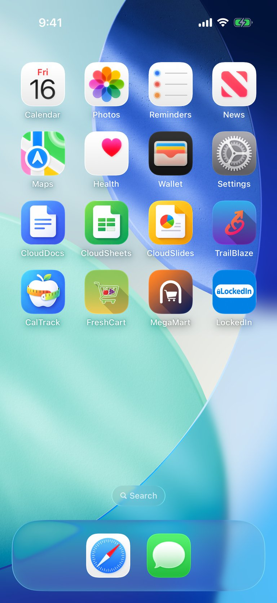

<details><summary>element list</summary>

```
- "Calendar" at (15.4%, 15.3%) size 72x91
- "Photos" at (38.5%, 15.3%) size 68x91
- "Reminders" at (61.6%, 15.3%) size 82x91
- "News" at (84.6%, 15.3%) size 68x91
- "Maps" at (15.5%, 26.7%) size 68x91
- "Health" at (38.5%, 26.7%) size 68x91
- "Wallet" at (61.6%, 26.7%) size 68x91
- "Settings" at (84.5%, 26.7%) size 68x91
- "CloudDocs" at (15.4%, 38.2%) size 83x91
- "CloudSheets" at (38.4%, 38.2%) size 94x91
- "CloudSlides" at (61.6%, 38.2%) size 89x91
- "TrailBlaze" at (84.5%, 38.2%) size 76x91
- "CalTrack" at (15.4%, 49.7%) size 71x91
- "FreshCart" at (38.4%, 49.7%) size 77x91
- "MegaMart" at (61.5%, 49.7%) size 79x91
- "LockedIn" at (84.5%, 49.7%) size 72x91
- "Search" at (50%, 82.2%) size 78x30
- "Search" at (44.6%, 82.2%) size 11x11
- "Search" at (51.8%, 82.2%) size 40x14
- "Dock" at (50%, 92.1%) size 402x103
- "Safari" at (39.1%, 92.1%) size 68x68
- "Messages" at (60.9%, 92.1%) size 68x68
```
</details>

### Step 1 — model (2.9 s, 5714 in / 31 out)
- calls `tap({"x":15.4,"y":49.7,"description":"Open CalTrack"})`

- `tap` → Tapped (15.4%, 49.7%) - Open CalTrack
#### Screen after step 1
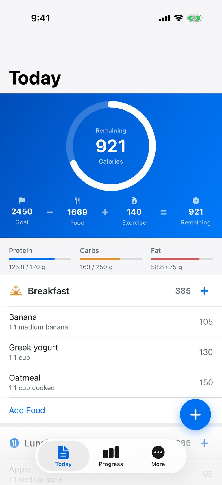

<details><summary>element list</summary>

```
- "CalTrack" at (50%, 50%) size 402x874
- "Today" at (15.8%, 16%) size 95x41
- "Remaining" at (50%, 26.9%) size 56x13
- "921" at (50%, 30.1%) size 56x38
- "Calories" at (50%, 33.3%) size 44x13
- "Flag" at (10%, 41.4%) size 11x12
- "Food" at (34.9%, 41.4%) size 8x14
- "Flame" at (60.5%, 41.4%) size 10x13
- "Selected" at (88.2%, 41.4%) size 12x12
- "2450" at (9.9%, 43.6%) size 39x18
- "−" at (22.5%, 43.6%) size 13x24
- "1669" at (34.9%, 43.7%) size 38x18
- "+" at (47.3%, 43.6%) size 13x24
- "140" at (60.5%, 43.7%) size 28x18
- "=" at (73.7%, 43.6%) size 13x24
- "921" at (88.2%, 43.6%) size 27x18
- "Goal" at (9.9%, 45.8%) size 24x13
- "Food" at (34.9%, 46%) size 26x13
- "Exercise" at (60.5%, 45.9%) size 44x13
- "Remaining" at (88.2%, 45.9%) size 55x13
- "Protein" at (9.3%, 51.7%) size 43x14
- "Carbs" at (40.3%, 51.7%) size 35x14
- "Fat" at (70.3%, 51.7%) size 19x14
- "125.8 / 170 g" at (12.3%, 55.1%) size 67x13
- "163 / 250 g" at (43.4%, 55.1%) size 60x13
- "58.8 / 75 g" at (75%, 55.1%) size 57x13
- "Sunrise" at (7.2%, 60%) size 24x19
- "Breakfast" at (21.9%, 60%) size 76x20
- "385" at (82.5%, 60%) size 29x18
- "Add" at (92%, 60%) size 32x32
- "Banana, 1 1 medium banana, 105" at (50%, 66.3%) size 402x54
- "Banana" at (10.3%, 65.4%) size 51x18
- "1 1 medium banana" at (17.4%, 67.4%) size 108x14
- "105" at (92.9%, 66.3%) size 25x18
- "Greek yogurt, 1 1 cup, 130" at (50%, 72.6%) size 402x54
- "Greek yogurt" at (15.1%, 71.6%) size 89x18
- "1 1 cup" at (8.8%, 73.7%) size 39x14
- "130" at (92.9%, 72.6%) size 25x18
- "Oatmeal, 1 1 cup cooked, 150" at (50%, 78.8%) size 402x54
- "Oatmeal" at (11.2%, 77.9%) size 58x18
- "1 1 cup cooked" at (14.4%, 80%) size 84x14
- "150" at (92.9%, 78.8%) size 25x18
- "Add Food" at (50%, 84.6%) size 402x46
- "fork.knife.circle.fill" at (6.5%, 91.3%) size 17x17
- "Lunch" at (17%, 91.3%) size 49x20
- "385" at (82.5%, 91.3%) size 29x18
- "Add" at (92%, 91.3%) size 32x32
- "Apple, 1 1 medium apple, 95" at (50%, 97.7%) size 402x54
- "Apple" at (8.9%, 96.8%) size 40x18
- "1 1 medium apple" at (16.1%, 98.8%) size 98x14
- "95" at (93.7%, 97.7%) size 19x18
- "Add" at (88.1%, 85.5%) size 56x56
- "Tab Bar" at (50%, 95.3%) size 402x83
- "Today" at (28.6%, 94.1%) size 94x54
- "text.document.fill" at (28.5%, 93.2%) size 25x29
- "Progress" at (50%, 94.1%) size 94x54
- "chart column" at (50.1%, 93.2%) size 35x25
- "More" at (71.4%, 94.1%) size 94x54
- "More" at (71.3%, 93.2%) size 27x27
```
</details>

### Step 2 — model (3.6 s, 6630 in / 56 out, 3633 cached)
- calls `tap({"x":92.0,"y":60.0,"description":"Add food to today's breakfast"})`

- `tap` → Tapped (92%, 60%) - Add food to today's breakfast
#### Screen after step 2
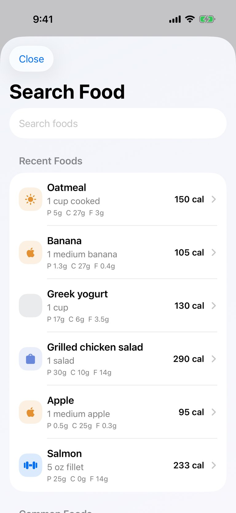

<details><summary>element list</summary>

```
- "CalTrack" at (50%, 50%) size 402x874
- "Close" at (13.3%, 11.4%) size 67x36
- "Search Food" at (28.6%, 17.8%) size 198x41
- text field "Search foods" (empty) at (50%, 24%) size 338x22
- "Recent Foods" at (50%, 31.3%) size 370x40
- "Oatmeal, 1 cup cooked, P 5g  C 27g  F 3g, 150 cal" at (50%, 38.8%) size 370x91
- "Brightness Higher" at (13%, 38.8%) size 19x19
- "Oatmeal" at (28.2%, 36.5%) size 67x20
- "1 cup cooked" at (31.2%, 39.2%) size 91x18
- "P 5g  C 27g  F 3g" at (32%, 41.5%) size 97x14
- "150 cal" at (80.2%, 38.8%) size 51x18
- "Banana, 1 medium banana, P 1.3g  C 27g  F 0.4g, 105 cal" at (50%, 49.2%) size 370x91
- "apple.logo" at (12.9%, 49.2%) size 14x17
- "Banana" at (27.3%, 46.9%) size 59x20
- "1 medium banana" at (34.8%, 49.5%) size 120x18
- "P 1.3g  C 27g  F 0.4g" at (34.4%, 51.8%) size 116x14
- "105 cal" at (80.2%, 49.2%) size 51x18
- "Greek yogurt, 1 cup, P 17g  C 6g  F 3.5g, 130 cal" at (50%, 59.6%) size 370x91
- "Greek yogurt" at (32.8%, 57.3%) size 104x20
- "1 cup" at (24.4%, 59.9%) size 36x18
- "P 17g  C 6g  F 3.5g" at (33.1%, 62.2%) size 106x14
- "130 cal" at (80.2%, 59.6%) size 51x18
- "Grilled chicken salad, 1 salad, P 30g  C 10g  F 14g, 290 cal" at (50%, 69.9%) size 370x91
- "Shopping Bag" at (12.9%, 69.9%) size 15x17
- "Grilled chicken salad" at (40.3%, 67.6%) size 164x20
- "1 salad" at (25.7%, 70.3%) size 47x18
- "P 30g  C 10g  F 14g" at (33.6%, 72.6%) size 110x14
- "290 cal" at (79.9%, 69.9%) size 53x18
- "Apple, 1 medium apple, P 0.5g  C 25g  F 0.3g, 95 cal" at (50%, 80.3%) size 370x91
- "apple.logo" at (12.9%, 80.3%) size 14x17
- "Apple" at (25.7%, 78%) size 46x20
- "1 medium apple" at (33.3%, 80.7%) size 108x18
- "P 0.5g  C 25g  F 0.3g" at (34.7%, 83%) size 119x14
- "95 cal" at (81.1%, 80.3%) size 44x18
- "Salmon, 5 oz fillet, P 25g  C 0g  F 14g, 233 cal" at (50%, 90.7%) size 370x91
- "dumbbell.fill" at (13%, 90.7%) size 23x13
- "Salmon" at (27.3%, 88.4%) size 59x20
- "5 oz fillet" at (27.7%, 91%) size 63x18
- "P 25g  C 0g  F 14g" at (32.9%, 93.3%) size 104x14
- "233 cal" at (80%, 90.7%) size 53x18
```
</details>

### Step 3 — model (2.8 s, 6559 in / 32 out, 3633 cached)
- calls `typeAndSubmit({"elementText":"Search foods","text":"oatmeal","submitKey":"enter"})`

- `typeAndSubmit` → Typed "oatmeal" into "Search foods" and submitted via enter
#### Screen after step 3
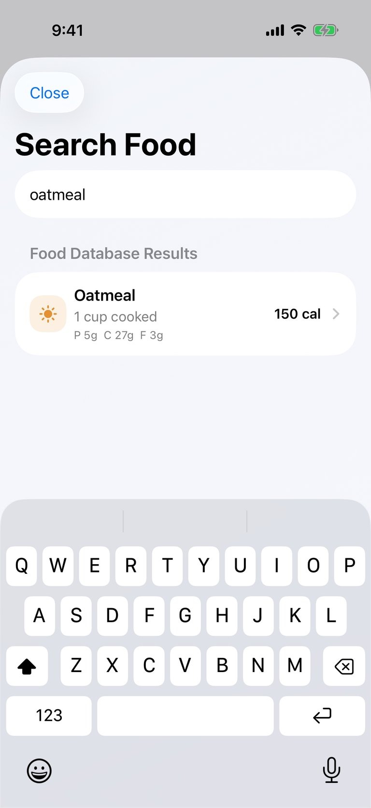

<details><summary>element list</summary>

```
- "CalTrack" at (50%, 50%) size 402x874
- "Close" at (13.3%, 11.4%) size 67x36
- "Search Food" at (28.6%, 17.8%) size 198x41
- text field "Search foods" = "oatmeal" at (50%, 24%) size 338x22
- "Food Database Results" at (50%, 31.3%) size 370x40
- "Oatmeal, 1 cup cooked, P 5g  C 27g  F 3g, 150 cal" at (50%, 38.8%) size 370x91
- "Brightness Higher" at (13%, 38.8%) size 19x19
- "Oatmeal" at (28.2%, 36.5%) size 67x20
- "1 cup cooked" at (31.2%, 39.2%) size 91x18
- "P 5g  C 27g  F 3g" at (32%, 41.5%) size 97x14
- "150 cal" at (80.2%, 38.8%) size 51x18
- "Typing Predictions" at (50%, 64.2%) size 402x44
- "Q" at (6.1%, 70.6%) size 39x54
- "W" at (15.9%, 70.6%) size 40x54
- "E" at (25.7%, 70.6%) size 39x54
- "R" at (35.5%, 70.6%) size 40x54
- "T" at (45.4%, 70.6%) size 39x54
- "Y" at (55.2%, 70.6%) size 40x54
- "U" at (65%, 70.6%) size 39x54
- "I" at (74.8%, 70.6%) size 40x54
- "O" at (84.7%, 70.6%) size 39x54
- "P" at (94.5%, 70.6%) size 40x54
- "A" at (10.9%, 76.8%) size 39x54
- "S" at (20.8%, 76.8%) size 40x54
- "D" at (30.6%, 76.8%) size 39x54
- "F" at (40.4%, 76.8%) size 40x54
- "G" at (50.2%, 76.8%) size 39x54
- "H" at (60.1%, 76.8%) size 40x54
- "J" at (69.9%, 76.8%) size 39x54
- "K" at (79.7%, 76.8%) size 40x54
- "L" at (89.6%, 76.8%) size 39x54
- "shift" at (7.5%, 83%) size 51x54
- "Z" at (20.8%, 83%) size 40x54
- "X" at (30.6%, 83%) size 39x54
- "C" at (40.4%, 83%) size 40x54
- "V" at (50.2%, 83%) size 39x54
- "B" at (60.1%, 83%) size 40x54
- "N" at (69.9%, 83%) size 39x54
- "M" at (79.7%, 83%) size 40x54
- "delete" at (93%, 83%) size 52x54
- "numbers" at (13.4%, 89.1%) size 99x54
- "return" at (87.1%, 89.1%) size 99x54
- "Emoji" at (10.6%, 96.1%) size 68x69
- "Dictate" at (89.4%, 96.1%) size 68x69
```
</details>

### Step 4 — model (3.2 s, 6553 in / 34 out, 3633 cached)
- calls `tap({"x":50.0,"y":38.8,"description":"Select oatmeal, one cup cooked"})`

- `tap` → Tapped (50%, 38.8%) - Select oatmeal, one cup cooked
#### Screen after step 4
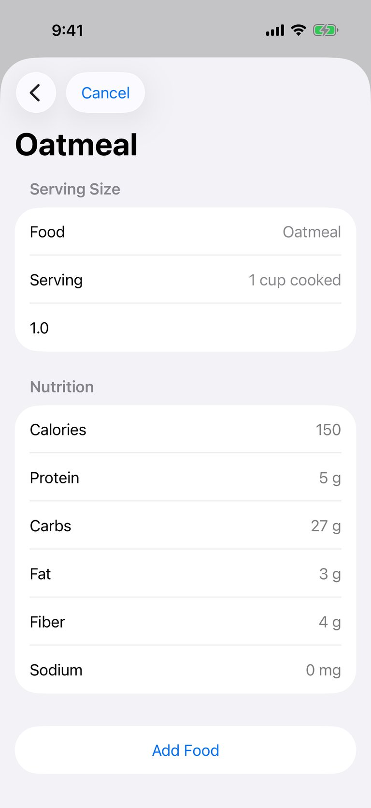

<details><summary>element list</summary>

```
- "CalTrack" at (50%, 50%) size 402x874
- "Search Food" at (9.5%, 11.4%) size 44x44
- "Cancel" at (28.4%, 11.4%) size 77x36
- "Oatmeal" at (20.6%, 17.8%) size 134x41
- "Serving Size" at (50%, 23.4%) size 370x40
- "Food" at (12.8%, 28.6%) size 39x20
- "Food, Oatmeal" at (50%, 28.6%) size 370x52
- "Serving" at (15.2%, 34.6%) size 58x20
- "Serving, 1 cup cooked" at (50%, 34.6%) size 370x52
- text field "Quantity" = "1.0" at (50%, 40.5%) size 338x22
- "Nutrition" at (50%, 47.8%) size 370x40
- "Calories" at (15.7%, 53.1%) size 62x20
- "150" at (88.6%, 53.1%) size 28x20
- "Protein" at (14.7%, 59.1%) size 54x20
- "5 g" at (89%, 59.1%) size 25x20
- "Carbs" at (13.6%, 65%) size 45x20
- "27 g" at (87.9%, 65%) size 34x20
- "Fat" at (10.9%, 71%) size 24x20
- "3 g" at (89%, 71%) size 25x20
- "Fiber" at (12.8%, 76.9%) size 39x20
- "4 g" at (88.9%, 76.9%) size 25x20
- "Sodium" at (15.1%, 82.9%) size 58x20
- "0 mg" at (87.2%, 82.9%) size 39x20
- "Add Food" at (50%, 92.8%) size 370x52
```
</details>

### Step 5 — model (3.0 s, 6214 in / 52 out, 3633 cached)
- calls `tap({"x":50.0,"y":92.8,"description":"Add one serving of oatmeal to breakfast"})`

- `tap` → Tapped (50%, 92.8%) - Add one serving of oatmeal to breakfast
#### Screen after step 5
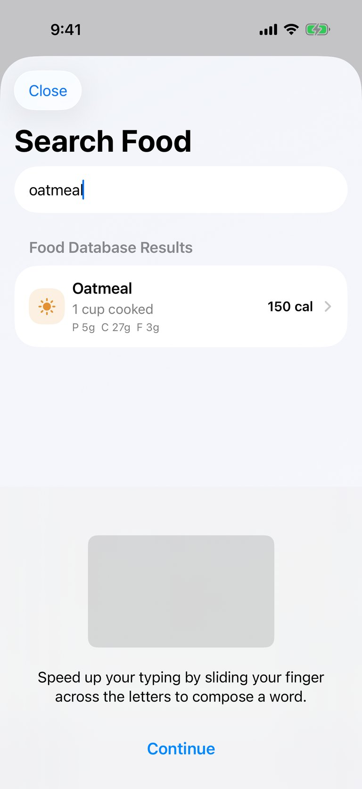

<details><summary>element list</summary>

```
- "CalTrack" at (50%, 50%) size 402x874
- "Close" at (13.3%, 11.4%) size 67x36
- "Search Food" at (28.6%, 17.8%) size 198x41
- text field "Search foods" = "oatmeal" at (50%, 24%) size 338x22
- "Food Database Results" at (50%, 31.3%) size 370x40
- "Oatmeal, 1 cup cooked, P 5g  C 27g  F 3g, 150 cal" at (50%, 38.8%) size 370x91
- "Brightness Higher" at (13%, 38.8%) size 19x19
- "Oatmeal" at (28.2%, 36.5%) size 67x20
- "1 cup cooked" at (31.2%, 39.2%) size 91x18
- "P 5g  C 27g  F 3g" at (32%, 41.5%) size 97x14
- "150 cal" at (80.2%, 38.8%) size 51x18
```
</details>

### Step 6 — model (2.7 s, 6100 in / 38 out, 3633 cached)
- calls `hideKeyboard({})`

- `hideKeyboard` → Keyboard hidden
#### Screen after step 6
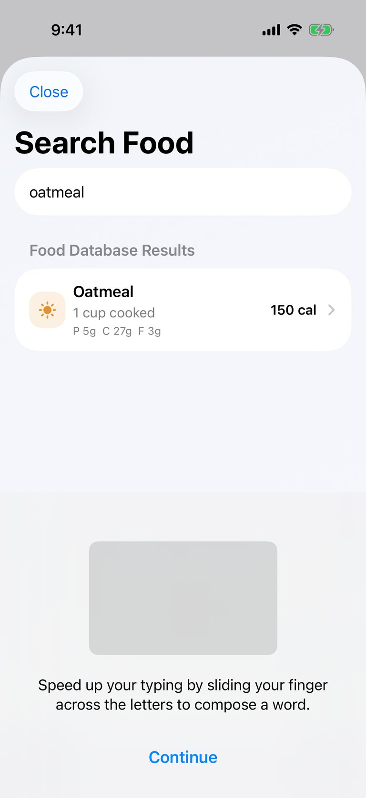

<details><summary>element list</summary>

```
- "CalTrack" at (50%, 50%) size 402x874
- "Close" at (13.3%, 11.4%) size 67x36
- "Search Food" at (28.6%, 17.8%) size 198x41
- text field "Search foods" = "oatmeal" at (50%, 24%) size 338x22
- "Food Database Results" at (50%, 31.3%) size 370x40
- "Oatmeal, 1 cup cooked, P 5g  C 27g  F 3g, 150 cal" at (50%, 38.8%) size 370x91
- "Brightness Higher" at (13%, 38.8%) size 19x19
- "Oatmeal" at (28.2%, 36.5%) size 67x20
- "1 cup cooked" at (31.2%, 39.2%) size 91x18
- "P 5g  C 27g  F 3g" at (32%, 41.5%) size 97x14
- "150 cal" at (80.2%, 38.8%) size 51x18
- "Speed up your typing by sliding your finger across the letters to compose a word." at (50%, 87%) size 320x46
- "Continue" at (50%, 94.9%) size 224x21
- "Continue" at (50%, 94.9%) size 76x22
```
</details>

### Step 7 — model (2.5 s, 6193 in / 32 out, 3633 cached)
- calls `tap({"x":50.0,"y":94.9,"description":"Dismiss keyboard typing tutorial"})`

- `tap` → Tapped (50%, 94.9%) - Dismiss keyboard typing tutorial
#### Screen after step 7


<details><summary>element list</summary>

```
- "CalTrack" at (50%, 50%) size 402x874
- "Close" at (13.3%, 11.4%) size 67x36
- "Search Food" at (28.6%, 17.8%) size 198x41
- text field "Search foods" = "oatmeal" at (50%, 24%) size 338x22
- "Food Database Results" at (50%, 31.3%) size 370x40
- "Oatmeal, 1 cup cooked, P 5g  C 27g  F 3g, 150 cal" at (50%, 38.8%) size 370x91
- "Brightness Higher" at (13%, 38.8%) size 19x19
- "Oatmeal" at (28.2%, 36.5%) size 67x20
- "1 cup cooked" at (31.2%, 39.2%) size 91x18
- "P 5g  C 27g  F 3g" at (32%, 41.5%) size 97x14
- "150 cal" at (80.2%, 38.8%) size 51x18
- "Typing Predictions" at (50%, 64.2%) size 402x44
- "q" at (6.1%, 70.6%) size 39x54
- "w" at (15.9%, 70.6%) size 40x54
- "e" at (25.7%, 70.6%) size 39x54
- "r" at (35.5%, 70.6%) size 40x54
- "t" at (45.4%, 70.6%) size 39x54
- "y" at (55.2%, 70.6%) size 40x54
- "u" at (65%, 70.6%) size 39x54
- "i" at (74.8%, 70.6%) size 40x54
- "o" at (84.7%, 70.6%) size 39x54
- "p" at (94.5%, 70.6%) size 40x54
- "a" at (10.9%, 76.8%) size 39x54
- "s" at (20.8%, 76.8%) size 40x54
- "d" at (30.6%, 76.8%) size 39x54
- "f" at (40.4%, 76.8%) size 40x54
- "g" at (50.2%, 76.8%) size 39x54
- "h" at (60.1%, 76.8%) size 40x54
- "j" at (69.9%, 76.8%) size 39x54
- "k" at (79.7%, 76.8%) size 40x54
- "l" at (89.6%, 76.8%) size 39x54
- "shift" at (7.5%, 83%) size 51x54
- "z" at (20.8%, 83%) size 40x54
- "x" at (30.6%, 83%) size 39x54
- "c" at (40.4%, 83%) size 40x54
- "v" at (50.2%, 83%) size 39x54
- "b" at (60.1%, 83%) size 40x54
- "n" at (69.9%, 83%) size 39x54
- "m" at (79.7%, 83%) size 40x54
- "delete" at (93%, 83%) size 52x54
- "numbers" at (13.4%, 89.1%) size 99x54
- "return" at (87.1%, 89.1%) size 99x54
- "Emoji" at (10.6%, 96.1%) size 68x69
- "Dictate" at (89.4%, 96.1%) size 68x69
```
</details>

### Step 8 — model (2.8 s, 6891 in / 32 out, 3633 cached)
- calls `tap({"x":50.0,"y":38.8,"description":"Open oatmeal serving details"})`

- `tap` → Tapped (50%, 38.8%) - Open oatmeal serving details
#### Screen after step 8
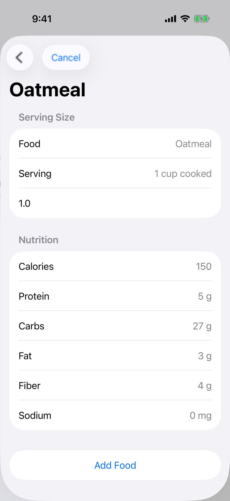

<details><summary>element list</summary>

```
- "CalTrack" at (50%, 50%) size 402x874
- "Search Food" at (9.5%, 11.4%) size 44x44
- "Cancel" at (28.4%, 11.4%) size 77x36
- "Oatmeal" at (20.6%, 17.8%) size 134x41
- "Serving Size" at (50%, 23.4%) size 370x40
- "Food" at (12.8%, 28.6%) size 39x20
- "Food, Oatmeal" at (50%, 28.6%) size 370x52
- "Serving" at (15.2%, 34.6%) size 58x20
- "Serving, 1 cup cooked" at (50%, 34.6%) size 370x52
- text field "Quantity" = "1.0" at (50%, 40.5%) size 338x22
- "Nutrition" at (50%, 47.8%) size 370x40
- "Calories" at (15.7%, 53.1%) size 62x20
- "150" at (88.6%, 53.1%) size 28x20
- "Protein" at (14.7%, 59.1%) size 54x20
- "5 g" at (89%, 59.1%) size 25x20
- "Carbs" at (13.6%, 65%) size 45x20
- "27 g" at (87.9%, 65%) size 34x20
- "Fat" at (10.9%, 71%) size 24x20
- "3 g" at (89%, 71%) size 25x20
- "Fiber" at (12.8%, 76.9%) size 39x20
- "4 g" at (88.9%, 76.9%) size 25x20
- "Sodium" at (15.1%, 82.9%) size 58x20
- "0 mg" at (87.2%, 82.9%) size 39x20
- "Add Food" at (50%, 92.8%) size 370x52
```
</details>

### Step 9 — model (3.2 s, 6546 in / 35 out, 3633 cached)
- calls `tap({"x":50.0,"y":92.8,"description":"Log one cup cooked oatmeal to breakfast"})`

- `tap` → Tapped (50%, 92.8%) - Log one cup cooked oatmeal to breakfast
#### Screen after step 9
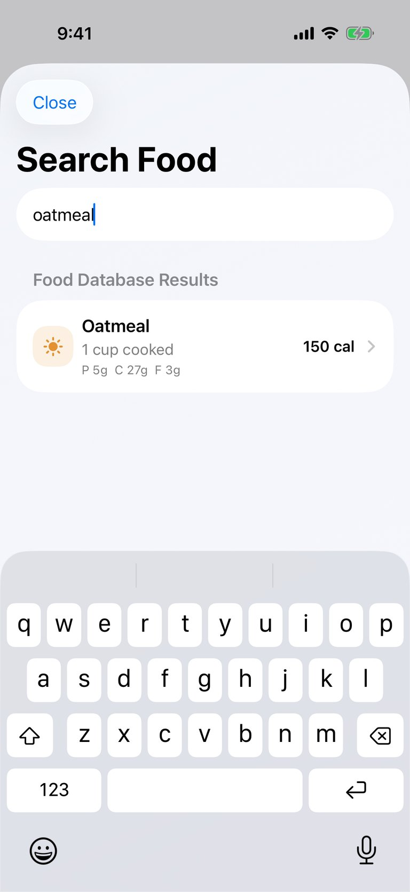

<details><summary>element list</summary>

```
- "CalTrack" at (50%, 50%) size 402x874
- "Close" at (13.3%, 11.4%) size 67x36
- "Search Food" at (28.6%, 17.8%) size 198x41
- text field "Search foods" = "oatmeal" at (50%, 24%) size 338x22
- "Food Database Results" at (50%, 31.3%) size 370x40
- "Oatmeal, 1 cup cooked, P 5g  C 27g  F 3g, 150 cal" at (50%, 38.8%) size 370x91
- "Brightness Higher" at (13%, 38.8%) size 19x19
- "Oatmeal" at (28.2%, 36.5%) size 67x20
- "1 cup cooked" at (31.2%, 39.2%) size 91x18
- "P 5g  C 27g  F 3g" at (32%, 41.5%) size 97x14
- "150 cal" at (80.2%, 38.8%) size 51x18
```
</details>

### Step 10 — model (4.6 s, 6455 in / 74 out, 3633 cached)
- calls `tap({"x":13.3,"y":11.4,"description":"Close food search and verify today's breakfast log"})`

- `tap` → Tapped (13.3%, 11.4%) - Close food search and verify today's breakfast log
#### Screen after step 10


<details><summary>element list</summary>

```
- "CalTrack" at (50%, 50%) size 402x874
- "Today" at (15.8%, 16%) size 95x41
- "Remaining" at (50%, 26.9%) size 56x13
- "621" at (50%, 30.1%) size 57x38
- "Calories" at (50%, 33.3%) size 44x13
- "Flag" at (10%, 41.4%) size 11x12
- "Food" at (34.9%, 41.4%) size 8x14
- "Flame" at (60.5%, 41.4%) size 10x13
- "Selected" at (88.2%, 41.4%) size 12x12
- "2450" at (9.9%, 43.6%) size 39x18
- "−" at (22.5%, 43.6%) size 13x24
- "1969" at (34.9%, 43.7%) size 38x18
- "+" at (47.3%, 43.6%) size 13x24
- "140" at (60.5%, 43.7%) size 28x18
- "=" at (73.7%, 43.6%) size 13x24
- "621" at (88.2%, 43.6%) size 27x18
- "Goal" at (9.9%, 45.8%) size 24x13
- "Food" at (34.9%, 46%) size 26x13
- "Exercise" at (60.5%, 45.9%) size 44x13
- "Remaining" at (88.2%, 45.9%) size 55x13
- "Protein" at (9.3%, 51.7%) size 43x14
- "Carbs" at (40.3%, 51.7%) size 35x14
- "Fat" at (70.3%, 51.7%) size 19x14
- "135.8 / 170 g" at (12.3%, 55.1%) size 67x13
- "217 / 250 g" at (43.3%, 55.1%) size 59x13
- "64.8 / 75 g" at (75%, 55.1%) size 57x13
- "Sunrise" at (7.2%, 60%) size 24x19
- "Breakfast" at (21.9%, 60%) size 76x20
- "685" at (82.4%, 60%) size 29x18
- "Add" at (92%, 60%) size 32x32
- "Banana, 1 1 medium banana, 105" at (50%, 66.3%) size 402x54
- "Banana" at (10.3%, 65.4%) size 51x18
- "1 1 medium banana" at (17.4%, 67.4%) size 108x14
- "105" at (92.9%, 66.3%) size 25x18
- "Greek yogurt, 1 1 cup, 130" at (50%, 72.6%) size 402x54
- "Greek yogurt" at (15.1%, 71.6%) size 89x18
- "1 1 cup" at (8.8%, 73.7%) size 39x14
- "130" at (92.9%, 72.6%) size 25x18
- "Oatmeal, 1 1 cup cooked, 150" at (50%, 78.8%) size 402x54
- "Oatmeal" at (11.2%, 77.9%) size 58x18
- "1 1 cup cooked" at (14.4%, 80%) size 84x14
- "150" at (92.9%, 78.8%) size 25x18
- "Oatmeal, 1 1 cup cooked, 150" at (50%, 85.1%) size 402x54
- "Oatmeal" at (11.2%, 84.1%) size 58x18
- "1 1 cup cooked" at (14.4%, 86.2%) size 84x14
- "150" at (92.9%, 85.1%) size 25x18
- "Oatmeal, 1 1 cup cooked, 150" at (50%, 91.3%) size 402x54
- "Oatmeal" at (11.2%, 90.4%) size 58x18
- "1 1 cup cooked" at (14.4%, 92.5%) size 84x14
- "150" at (92.9%, 91.3%) size 25x18
- "Add Food" at (50%, 97.1%) size 402x46
- "Add" at (88.1%, 85.5%) size 56x56
- "Tab Bar" at (50%, 95.3%) size 402x83
- "Today" at (28.6%, 94.1%) size 94x54
- "text.document.fill" at (28.5%, 93.2%) size 25x29
- "Progress" at (50%, 94.1%) size 94x54
- "chart column" at (50.1%, 93.2%) size 35x25
- "More" at (71.4%, 94.1%) size 94x54
- "More" at (71.3%, 93.2%) size 27x27
```
</details>

### Step 11 — model (6.0 s, 7629 in / 192 out, 3633 cached)
- calls `tap({"x":46.9,"y":85.1,"description":"Inspect the extra oatmeal entry so I can correct the duplicate"})`

- `tap` → Tapped (46.9%, 85.1%) - Inspect the extra oatmeal entry so I can correct the duplicate
#### Screen after step 11
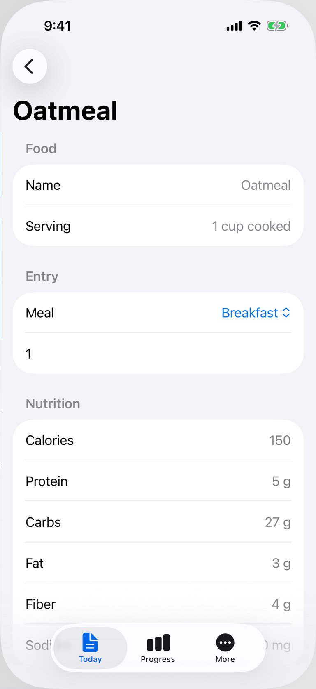

<details><summary>element list</summary>

```
- "CalTrack" at (50%, 50%) size 402x874
- "Today" at (9.5%, 9.6%) size 44x44
- "Oatmeal" at (20.6%, 16%) size 134x41
- "Food" at (50%, 21.5%) size 370x40
- "Name" at (13.6%, 26.8%) size 45x20
- "Name, Oatmeal" at (50%, 26.8%) size 370x52
- "Serving" at (15.2%, 32.8%) size 58x20
- "Serving, 1 cup cooked" at (50%, 32.8%) size 370x52
- "Entry" at (50%, 40.1%) size 370x40
- "Meal" at (12.5%, 45.3%) size 37x20
- "Meal, Breakfast" at (50%, 45.4%) size 338x34
- "Breakfast" at (79%, 45.4%) size 72x20
- text field "Quantity" = "1" at (50%, 51.3%) size 338x22
- "Nutrition" at (50%, 58.6%) size 370x40
- "Calories" at (15.7%, 63.8%) size 62x20
- "150" at (88.6%, 63.8%) size 28x20
- "Protein" at (14.7%, 69.8%) size 54x20
- "5 g" at (89%, 69.8%) size 25x20
- "Carbs" at (13.6%, 75.7%) size 45x20
- "27 g" at (87.9%, 75.7%) size 34x20
- "Fat" at (10.9%, 81.7%) size 24x20
- "3 g" at (89%, 81.7%) size 25x20
- "Fiber" at (12.8%, 87.6%) size 39x20
- "4 g" at (88.9%, 87.6%) size 25x20
- "Sodium" at (15.1%, 93.6%) size 58x20
- "0 mg" at (87.2%, 93.6%) size 39x20
- "Tab Bar" at (50%, 95.3%) size 402x83
- "Today" at (28.6%, 94.1%) size 94x54
- "text.document.fill" at (28.5%, 93.2%) size 25x29
- "Progress" at (50%, 94.1%) size 94x54
- "chart column" at (50.1%, 93.2%) size 35x25
- "More" at (71.4%, 94.1%) size 94x54
- "More" at (71.3%, 93.2%) size 27x27
```
</details>

### Step 12 — model (2.3 s, 7292 in / 60 out, 3633 cached)
- calls `tap({"x":9.5,"y":9.6,"description":"Return to today's breakfast entries"})`

- `tap` → Tapped (9.5%, 9.6%) - Return to today's breakfast entries
#### Screen after step 12
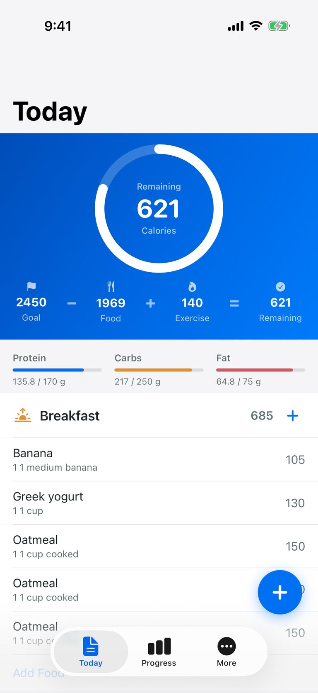

<details><summary>element list</summary>

```
- "CalTrack" at (50%, 50%) size 402x874
- "Today" at (15.8%, 16%) size 95x41
- "Remaining" at (50%, 26.9%) size 56x13
- "621" at (50%, 30.1%) size 57x38
- "Calories" at (50%, 33.3%) size 44x13
- "Flag" at (10%, 41.4%) size 11x12
- "Food" at (34.9%, 41.4%) size 8x14
- "Flame" at (60.5%, 41.4%) size 10x13
- "Selected" at (88.2%, 41.4%) size 12x12
- "2450" at (9.9%, 43.6%) size 39x18
- "−" at (22.5%, 43.6%) size 13x24
- "1969" at (34.9%, 43.7%) size 38x18
- "+" at (47.3%, 43.6%) size 13x24
- "140" at (60.5%, 43.7%) size 28x18
- "=" at (73.7%, 43.6%) size 13x24
- "621" at (88.2%, 43.6%) size 27x18
- "Goal" at (9.9%, 45.8%) size 24x13
- "Food" at (34.9%, 46%) size 26x13
- "Exercise" at (60.5%, 45.9%) size 44x13
- "Remaining" at (88.2%, 45.9%) size 55x13
- "Protein" at (9.3%, 51.7%) size 43x14
- "Carbs" at (40.3%, 51.7%) size 35x14
- "Fat" at (70.3%, 51.7%) size 19x14
- "135.8 / 170 g" at (12.3%, 55.1%) size 67x13
- "217 / 250 g" at (43.3%, 55.1%) size 59x13
- "64.8 / 75 g" at (75%, 55.1%) size 57x13
- "Sunrise" at (7.2%, 60%) size 24x19
- "Breakfast" at (21.9%, 60%) size 76x20
- "685" at (82.4%, 60%) size 29x18
- "Add" at (92%, 60%) size 32x32
- "Banana, 1 1 medium banana, 105" at (50%, 66.3%) size 402x54
- "Banana" at (10.3%, 65.4%) size 51x18
- "1 1 medium banana" at (17.4%, 67.4%) size 108x14
- "105" at (92.9%, 66.3%) size 25x18
- "Greek yogurt, 1 1 cup, 130" at (50%, 72.6%) size 402x54
- "Greek yogurt" at (15.1%, 71.6%) size 89x18
- "1 1 cup" at (8.8%, 73.7%) size 39x14
- "130" at (92.9%, 72.6%) size 25x18
- "Oatmeal, 1 1 cup cooked, 150" at (50%, 78.8%) size 402x54
- "Oatmeal" at (11.2%, 77.9%) size 58x18
- "1 1 cup cooked" at (14.4%, 80%) size 84x14
- "150" at (92.9%, 78.8%) size 25x18
- "Oatmeal, 1 1 cup cooked, 150" at (50%, 85.1%) size 402x54
- "Oatmeal" at (11.2%, 84.1%) size 58x18
- "1 1 cup cooked" at (14.4%, 86.2%) size 84x14
- "150" at (92.9%, 85.1%) size 25x18
- "Oatmeal, 1 1 cup cooked, 150" at (50%, 91.3%) size 402x54
- "Oatmeal" at (11.2%, 90.4%) size 58x18
- "1 1 cup cooked" at (14.4%, 92.5%) size 84x14
- "150" at (92.9%, 91.3%) size 25x18
- "Add Food" at (50%, 97.1%) size 402x46
- "Add" at (88.1%, 85.5%) size 56x56
- "Tab Bar" at (50%, 95.3%) size 402x83
- "Today" at (28.6%, 94.1%) size 94x54
- "text.document.fill" at (28.5%, 93.2%) size 25x29
- "Progress" at (50%, 94.1%) size 94x54
- "chart column" at (50.1%, 93.2%) size 35x25
- "More" at (71.4%, 94.1%) size 94x54
- "More" at (71.3%, 93.2%) size 27x27
```
</details>

### Step 13 — model (3.4 s, 8025 in / 67 out, 3633 cached)
- calls `swipe({"startX":76.0,"startY":85.0,"endX":19.0,"endY":85.0})`

- `swipe` → Swiped
#### Screen after step 13


<details><summary>element list</summary>

```
- "CalTrack" at (50%, 50%) size 402x874
- "Today" at (9.5%, 9.6%) size 44x44
- "Oatmeal" at (20.6%, 16%) size 134x41
- "Food" at (50%, 21.5%) size 370x40
- "Name" at (13.6%, 26.8%) size 45x20
- "Name, Oatmeal" at (50%, 26.8%) size 370x52
- "Serving" at (15.2%, 32.8%) size 58x20
- "Serving, 1 cup cooked" at (50%, 32.8%) size 370x52
- "Entry" at (50%, 40.1%) size 370x40
- "Meal" at (12.5%, 45.3%) size 37x20
- "Meal, Breakfast" at (50%, 45.4%) size 338x34
- "Breakfast" at (79%, 45.4%) size 72x20
- text field "Quantity" = "1" at (50%, 51.3%) size 338x22
- "Nutrition" at (50%, 58.6%) size 370x40
- "Calories" at (15.7%, 63.8%) size 62x20
- "150" at (88.6%, 63.8%) size 28x20
- "Protein" at (14.7%, 69.8%) size 54x20
- "5 g" at (89%, 69.8%) size 25x20
- "Carbs" at (13.6%, 75.7%) size 45x20
- "27 g" at (87.9%, 75.7%) size 34x20
- "Fat" at (10.9%, 81.7%) size 24x20
- "3 g" at (89%, 81.7%) size 25x20
- "Fiber" at (12.8%, 87.6%) size 39x20
- "4 g" at (88.9%, 87.6%) size 25x20
- "Sodium" at (15.1%, 93.6%) size 58x20
- "0 mg" at (87.2%, 93.6%) size 39x20
- "Tab Bar" at (50%, 95.3%) size 402x83
- "Today" at (28.6%, 94.1%) size 94x54
- "text.document.fill" at (28.5%, 93.2%) size 25x29
- "Progress" at (50%, 94.1%) size 94x54
- "chart column" at (50.1%, 93.2%) size 35x25
- "More" at (71.4%, 94.1%) size 94x54
- "More" at (71.3%, 93.2%) size 27x27
```
</details>

### Step 14 — model (4.2 s, 7535 in / 74 out, 3633 cached)
- calls `tap({"x":9.5,"y":9.6,"description":"Return to today's food log"})`

- `tap` → Tapped (9.5%, 9.6%) - Return to today's food log
#### Screen after step 14


<details><summary>element list</summary>

```
- "CalTrack" at (50%, 50%) size 402x874
- "Today" at (15.8%, 16%) size 95x41
- "Remaining" at (50%, 26.9%) size 56x13
- "621" at (50%, 30.1%) size 57x38
- "Calories" at (50%, 33.3%) size 44x13
- "Flag" at (10%, 41.4%) size 11x12
- "Food" at (34.9%, 41.4%) size 8x14
- "Flame" at (60.5%, 41.4%) size 10x13
- "Selected" at (88.2%, 41.4%) size 12x12
- "2450" at (9.9%, 43.6%) size 39x18
- "−" at (22.5%, 43.6%) size 13x24
- "1969" at (34.9%, 43.7%) size 38x18
- "+" at (47.3%, 43.6%) size 13x24
- "140" at (60.5%, 43.7%) size 28x18
- "=" at (73.7%, 43.6%) size 13x24
- "621" at (88.2%, 43.6%) size 27x18
- "Goal" at (9.9%, 45.8%) size 24x13
- "Food" at (34.9%, 46%) size 26x13
- "Exercise" at (60.5%, 45.9%) size 44x13
- "Remaining" at (88.2%, 45.9%) size 55x13
- "Protein" at (9.3%, 51.7%) size 43x14
- "Carbs" at (40.3%, 51.7%) size 35x14
- "Fat" at (70.3%, 51.7%) size 19x14
- "135.8 / 170 g" at (12.3%, 55.1%) size 67x13
- "217 / 250 g" at (43.3%, 55.1%) size 59x13
- "64.8 / 75 g" at (75%, 55.1%) size 57x13
- "Sunrise" at (7.2%, 60%) size 24x19
- "Breakfast" at (21.9%, 60%) size 76x20
- "685" at (82.4%, 60%) size 29x18
- "Add" at (92%, 60%) size 32x32
- "Banana, 1 1 medium banana, 105" at (50%, 66.3%) size 402x54
- "Banana" at (10.3%, 65.4%) size 51x18
- "1 1 medium banana" at (17.4%, 67.4%) size 108x14
- "105" at (92.9%, 66.3%) size 25x18
- "Greek yogurt, 1 1 cup, 130" at (50%, 72.6%) size 402x54
- "Greek yogurt" at (15.1%, 71.6%) size 89x18
- "1 1 cup" at (8.8%, 73.7%) size 39x14
- "130" at (92.9%, 72.6%) size 25x18
- "Oatmeal, 1 1 cup cooked, 150" at (50%, 78.8%) size 402x54
- "Oatmeal" at (11.2%, 77.9%) size 58x18
- "1 1 cup cooked" at (14.4%, 80%) size 84x14
- "150" at (92.9%, 78.8%) size 25x18
- "Oatmeal, 1 1 cup cooked, 150" at (50%, 85.1%) size 402x54
- "Oatmeal" at (11.2%, 84.1%) size 58x18
- "1 1 cup cooked" at (14.4%, 86.2%) size 84x14
- "150" at (92.9%, 85.1%) size 25x18
- "Oatmeal, 1 1 cup cooked, 150" at (50%, 91.3%) size 402x54
- "Oatmeal" at (11.2%, 90.4%) size 58x18
- "1 1 cup cooked" at (14.4%, 92.5%) size 84x14
- "150" at (92.9%, 91.3%) size 25x18
- "Add Food" at (50%, 97.1%) size 402x46
- "Add" at (88.1%, 85.5%) size 56x56
- "Tab Bar" at (50%, 95.3%) size 402x83
- "Today" at (28.6%, 94.1%) size 94x54
- "text.document.fill" at (28.5%, 93.2%) size 25x29
- "Progress" at (50%, 94.1%) size 94x54
- "chart column" at (50.1%, 93.2%) size 35x25
- "More" at (71.4%, 94.1%) size 94x54
- "More" at (71.3%, 93.2%) size 27x27
```
</details>

### Step 15 — model (2.8 s, 8322 in / 57 out, 3633 cached)
- calls `swipe({"startX":76.0,"startY":85.1,"endX":25.0,"endY":85.1})`

- `swipe` → Swiped
#### Screen after step 15
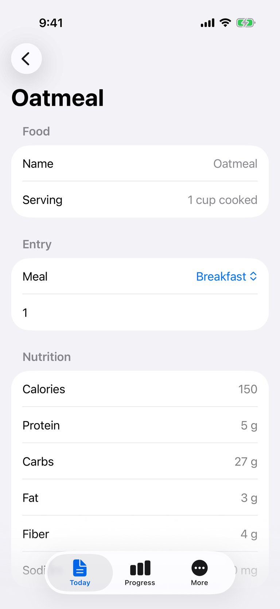

<details><summary>element list</summary>

```
- "CalTrack" at (50%, 50%) size 402x874
- "Today" at (9.5%, 9.6%) size 44x44
- "Oatmeal" at (20.6%, 16%) size 134x41
- "Food" at (50%, 21.5%) size 370x40
- "Name" at (13.6%, 26.8%) size 45x20
- "Name, Oatmeal" at (50%, 26.8%) size 370x52
- "Serving" at (15.2%, 32.8%) size 58x20
- "Serving, 1 cup cooked" at (50%, 32.8%) size 370x52
- "Entry" at (50%, 40.1%) size 370x40
- "Meal" at (12.5%, 45.3%) size 37x20
- "Meal, Breakfast" at (50%, 45.4%) size 338x34
- "Breakfast" at (79%, 45.4%) size 72x20
- text field "Quantity" = "1" at (50%, 51.3%) size 338x22
- "Nutrition" at (50%, 58.6%) size 370x40
- "Calories" at (15.7%, 63.8%) size 62x20
- "150" at (88.6%, 63.8%) size 28x20
- "Protein" at (14.7%, 69.8%) size 54x20
- "5 g" at (89%, 69.8%) size 25x20
- "Carbs" at (13.6%, 75.7%) size 45x20
- "27 g" at (87.9%, 75.7%) size 34x20
- "Fat" at (10.9%, 81.7%) size 24x20
- "3 g" at (89%, 81.7%) size 25x20
- "Fiber" at (12.8%, 87.6%) size 39x20
- "4 g" at (88.9%, 87.6%) size 25x20
- "Sodium" at (15.1%, 93.6%) size 58x20
- "0 mg" at (87.2%, 93.6%) size 39x20
- "Tab Bar" at (50%, 95.3%) size 402x83
- "Today" at (28.6%, 94.1%) size 94x54
- "text.document.fill" at (28.5%, 93.2%) size 25x29
- "Progress" at (50%, 94.1%) size 94x54
- "chart column" at (50.1%, 93.2%) size 35x25
- "More" at (71.4%, 94.1%) size 94x54
- "More" at (71.3%, 93.2%) size 27x27
```
</details>

### Step 16 — model (2.5 s, 7826 in / 41 out, 3633 cached)
- calls `tapText({"text":"Today"})`

- `tapText` → Tapped "Today" at (38, 84) pt
#### Screen after step 16


<details><summary>element list</summary>

```
- "CalTrack" at (50%, 50%) size 402x874
- "Today" at (15.8%, 16%) size 95x41
- "Remaining" at (50%, 26.9%) size 56x13
- "621" at (50%, 30.1%) size 57x38
- "Calories" at (50%, 33.3%) size 44x13
- "Flag" at (10%, 41.4%) size 11x12
- "Food" at (34.9%, 41.4%) size 8x14
- "Flame" at (60.5%, 41.4%) size 10x13
- "Selected" at (88.2%, 41.4%) size 12x12
- "2450" at (9.9%, 43.6%) size 39x18
- "−" at (22.5%, 43.6%) size 13x24
- "1969" at (34.9%, 43.7%) size 38x18
- "+" at (47.3%, 43.6%) size 13x24
- "140" at (60.5%, 43.7%) size 28x18
- "=" at (73.7%, 43.6%) size 13x24
- "621" at (88.2%, 43.6%) size 27x18
- "Goal" at (9.9%, 45.8%) size 24x13
- "Food" at (34.9%, 46%) size 26x13
- "Exercise" at (60.5%, 45.9%) size 44x13
- "Remaining" at (88.2%, 45.9%) size 55x13
- "Protein" at (9.3%, 51.7%) size 43x14
- "Carbs" at (40.3%, 51.7%) size 35x14
- "Fat" at (70.3%, 51.7%) size 19x14
- "135.8 / 170 g" at (12.3%, 55.1%) size 67x13
- "217 / 250 g" at (43.3%, 55.1%) size 59x13
- "64.8 / 75 g" at (75%, 55.1%) size 57x13
- "Sunrise" at (7.2%, 60%) size 24x19
- "Breakfast" at (21.9%, 60%) size 76x20
- "685" at (82.4%, 60%) size 29x18
- "Add" at (92%, 60%) size 32x32
- "Banana, 1 1 medium banana, 105" at (50%, 66.3%) size 402x54
- "Banana" at (10.3%, 65.4%) size 51x18
- "1 1 medium banana" at (17.4%, 67.4%) size 108x14
- "105" at (92.9%, 66.3%) size 25x18
- "Greek yogurt, 1 1 cup, 130" at (50%, 72.6%) size 402x54
- "Greek yogurt" at (15.1%, 71.6%) size 89x18
- "1 1 cup" at (8.8%, 73.7%) size 39x14
- "130" at (92.9%, 72.6%) size 25x18
- "Oatmeal, 1 1 cup cooked, 150" at (50%, 78.8%) size 402x54
- "Oatmeal" at (11.2%, 77.9%) size 58x18
- "1 1 cup cooked" at (14.4%, 80%) size 84x14
- "150" at (92.9%, 78.8%) size 25x18
- "Oatmeal, 1 1 cup cooked, 150" at (50%, 85.1%) size 402x54
- "Oatmeal" at (11.2%, 84.1%) size 58x18
- "1 1 cup cooked" at (14.4%, 86.2%) size 84x14
- "150" at (92.9%, 85.1%) size 25x18
- "Oatmeal, 1 1 cup cooked, 150" at (50%, 91.3%) size 402x54
- "Oatmeal" at (11.2%, 90.4%) size 58x18
- "1 1 cup cooked" at (14.4%, 92.5%) size 84x14
- "150" at (92.9%, 91.3%) size 25x18
- "Add Food" at (50%, 97.1%) size 402x46
- "Add" at (88.1%, 85.5%) size 56x56
- "Tab Bar" at (50%, 95.3%) size 402x83
- "Today" at (28.6%, 94.1%) size 94x54
- "text.document.fill" at (28.5%, 93.2%) size 25x29
- "Progress" at (50%, 94.1%) size 94x54
- "chart column" at (50.1%, 93.2%) size 35x25
- "More" at (71.4%, 94.1%) size 94x54
- "More" at (71.3%, 93.2%) size 27x27
```
</details>

### Step 17 — model (4.1 s, 8524 in / 94 out, 3633 cached)
- calls `swipe({"startX":60.0,"startY":78.8,"endX":10.0,"endY":78.8})`

- `swipe` → Swiped
#### Screen after step 17


<details><summary>element list</summary>

```
- "CalTrack" at (50%, 50%) size 402x874
- "Today" at (9.5%, 9.6%) size 44x44
- "Oatmeal" at (20.6%, 16%) size 134x41
- "Food" at (50%, 21.5%) size 370x40
- "Name" at (13.6%, 26.8%) size 45x20
- "Name, Oatmeal" at (50%, 26.8%) size 370x52
- "Serving" at (15.2%, 32.8%) size 58x20
- "Serving, 1 cup cooked" at (50%, 32.8%) size 370x52
- "Entry" at (50%, 40.1%) size 370x40
- "Meal" at (12.5%, 45.3%) size 37x20
- "Meal, Breakfast" at (50%, 45.4%) size 338x34
- "Breakfast" at (79%, 45.4%) size 72x20
- text field "Quantity" = "1" at (50%, 51.3%) size 338x22
- "Nutrition" at (50%, 58.6%) size 370x40
- "Calories" at (15.7%, 63.8%) size 62x20
- "150" at (88.6%, 63.8%) size 28x20
- "Protein" at (14.7%, 69.8%) size 54x20
- "5 g" at (89%, 69.8%) size 25x20
- "Carbs" at (13.6%, 75.7%) size 45x20
- "27 g" at (87.9%, 75.7%) size 34x20
- "Fat" at (10.9%, 81.7%) size 24x20
- "3 g" at (89%, 81.7%) size 25x20
- "Fiber" at (12.8%, 87.6%) size 39x20
- "4 g" at (88.9%, 87.6%) size 25x20
- "Sodium" at (15.1%, 93.6%) size 58x20
- "0 mg" at (87.2%, 93.6%) size 39x20
- "Tab Bar" at (50%, 95.3%) size 402x83
- "Today" at (28.6%, 94.1%) size 94x54
- "text.document.fill" at (28.5%, 93.2%) size 25x29
- "Progress" at (50%, 94.1%) size 94x54
- "chart column" at (50.1%, 93.2%) size 35x25
- "More" at (71.4%, 94.1%) size 94x54
- "More" at (71.3%, 93.2%) size 27x27
```
</details>
