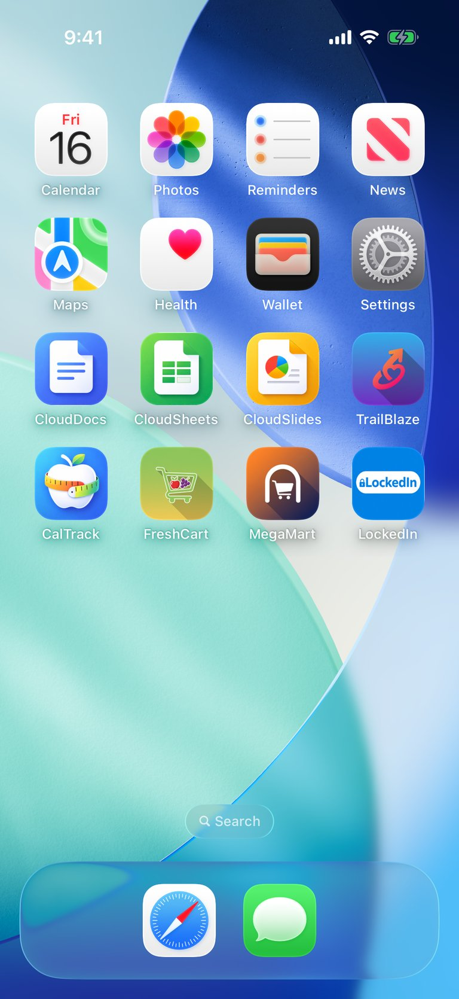
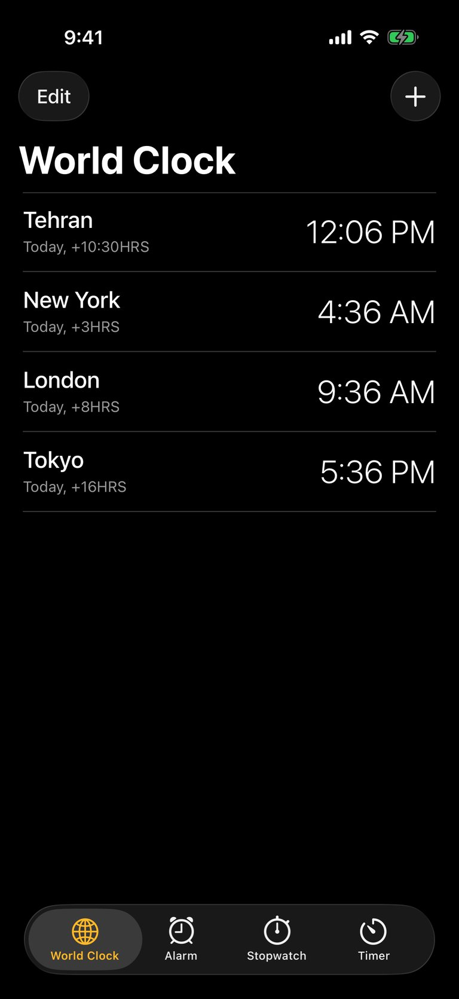
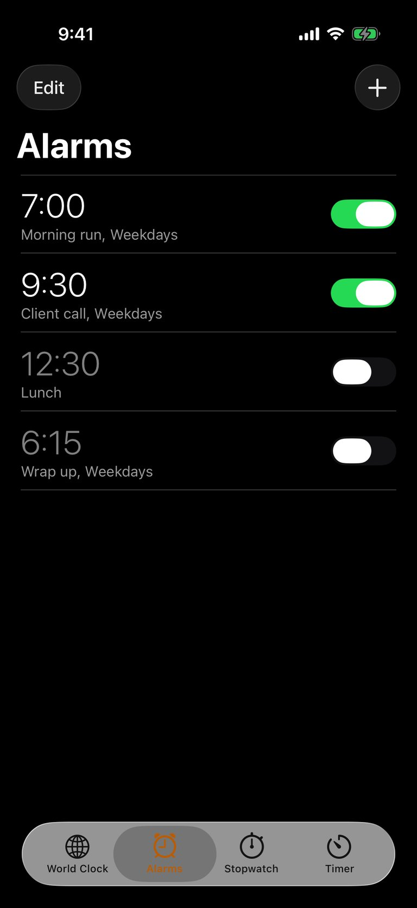
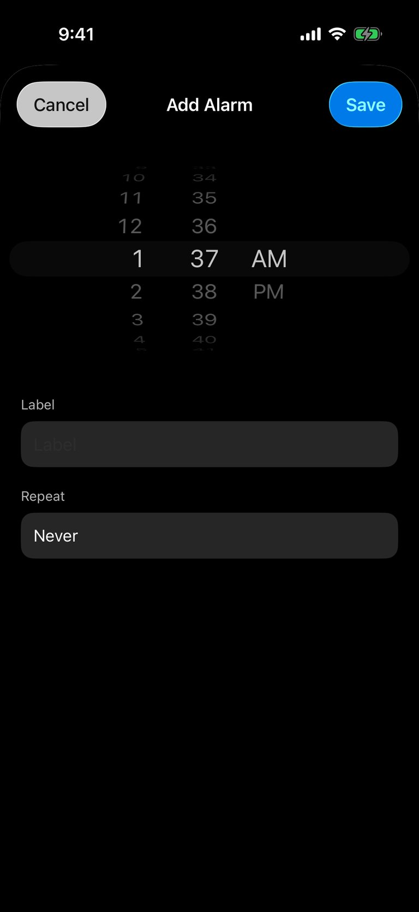
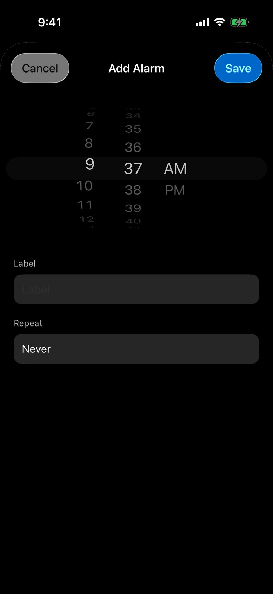
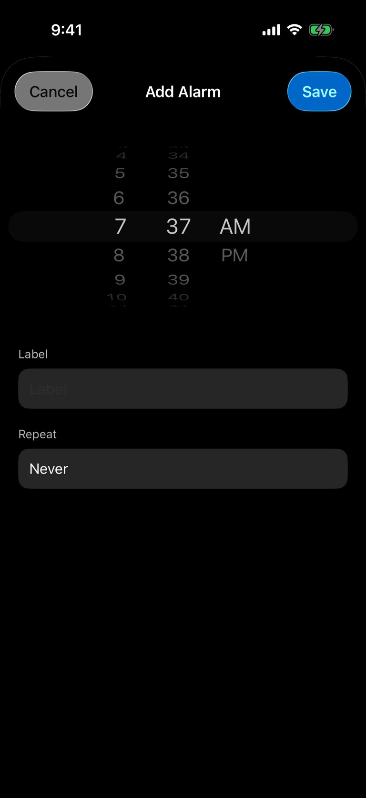
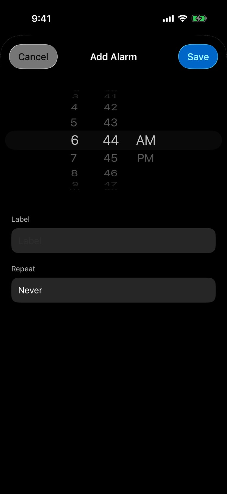
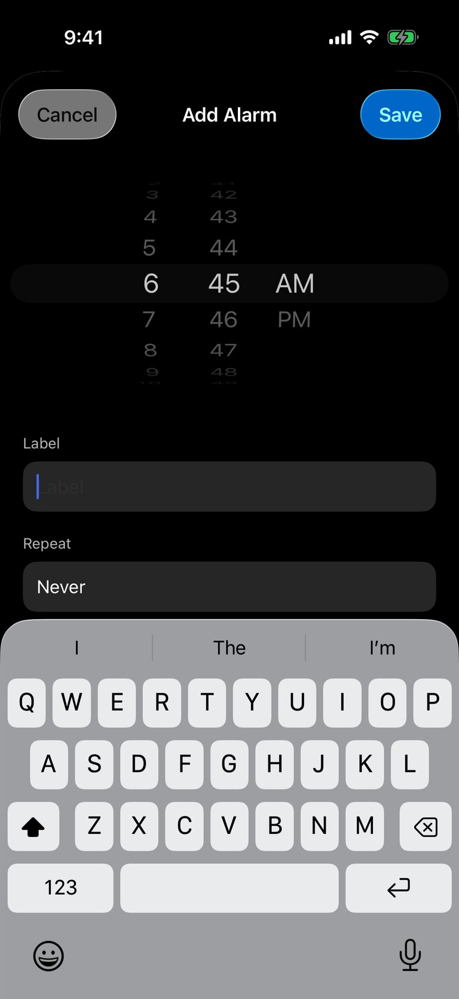
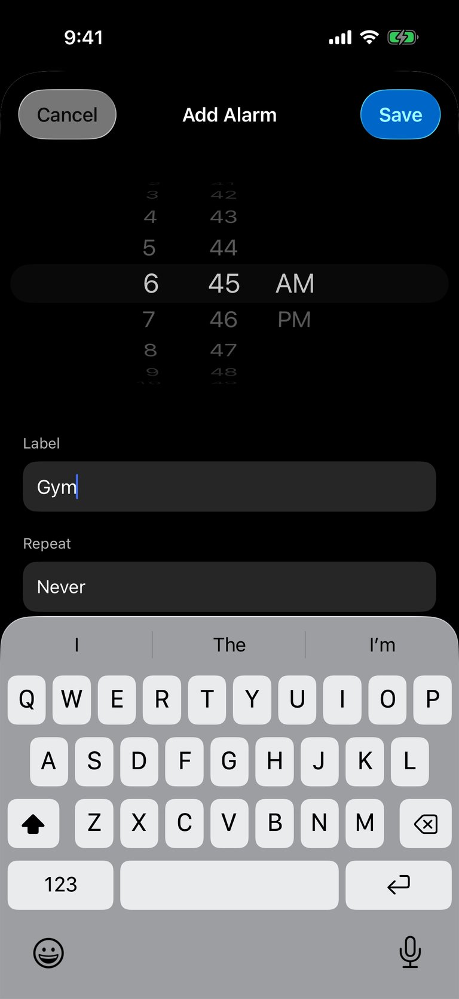
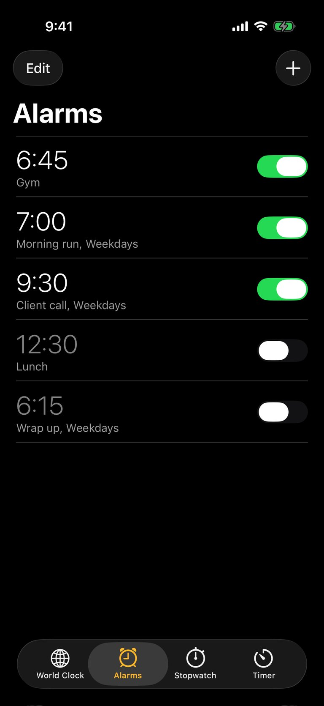

# Set a new alarm for 6:45 AM labeled 'Gym' in the Clock app and confirm it's set.

openai · gpt-6.1-sol · completed — Set and confirmed: the “Gym” alarm is enabled for 6:45 AM.

13 model calls · 13 tool calls (0 failed) · 84879 input tokens (47229 cached) · 742 output · 55.9 s

#### Screen after step 0


<details><summary>element list</summary>

```
- "Calendar" at (15.4%, 15.3%) size 72x91
- "Photos" at (38.5%, 15.3%) size 68x91
- "Reminders" at (61.6%, 15.3%) size 82x91
- "News" at (84.6%, 15.3%) size 68x91
- "Maps" at (15.5%, 26.7%) size 68x91
- "Health" at (38.5%, 26.7%) size 68x91
- "Wallet" at (61.6%, 26.7%) size 68x91
- "Settings" at (84.5%, 26.7%) size 68x91
- "CloudDocs" at (15.4%, 38.2%) size 83x91
- "CloudSheets" at (38.4%, 38.2%) size 94x91
- "CloudSlides" at (61.6%, 38.2%) size 89x91
- "TrailBlaze" at (84.5%, 38.2%) size 76x91
- "CalTrack" at (15.4%, 49.7%) size 71x91
- "FreshCart" at (38.4%, 49.7%) size 77x91
- "MegaMart" at (61.5%, 49.7%) size 79x91
- "LockedIn" at (84.5%, 49.7%) size 72x91
- "Search" at (50%, 82.2%) size 78x30
- "Search" at (44.6%, 82.2%) size 11x11
- "Search" at (51.8%, 82.2%) size 40x14
- "Dock" at (50%, 92.1%) size 402x103
- "Safari" at (39.1%, 92.1%) size 68x68
- "Messages" at (60.9%, 92.1%) size 68x68
```
</details>

### Step 1 — model (2.3 s, 5708 in / 19 out, 3633 cached)
- calls `openApp({"appName":"Clock"})`

- `openApp` → Opened Clock
#### Screen after step 1


<details><summary>element list</summary>

```
- "Clock" at (50%, 50%) size 402x874
- "Edit" at (11.7%, 9.6%) size 54x36
- "Add" at (90.5%, 9.6%) size 36x36
- "World Clock" at (27.7%, 16%) size 191x41
- "Tehran" at (12.6%, 22%) size 62x24
- "Today, +10:30HRS" at (18.8%, 24.7%) size 111x16
- "12:06 PM" at (80.8%, 23.2%) size 114x34
- "New York" at (15.6%, 30%) size 86x24
- "Today, +3HRS" at (15.6%, 32.7%) size 85x16
- "4:36 AM" at (82.1%, 31.2%) size 104x34
- "London" at (13.4%, 38%) size 68x24
- "Today, +8HRS" at (15.6%, 40.7%) size 85x16
- "9:36 AM" at (82%, 39.2%) size 104x34
- "Tokyo" at (11.7%, 46%) size 54x24
- "Today, +16HRS" at (16.3%, 48.7%) size 91x16
- "5:36 PM" at (82.3%, 47.2%) size 102x34
- "Tab Bar" at (50%, 95.3%) size 402x83
- "World Clock" at (18.6%, 94.1%) size 100x54
- "Globe" at (18.6%, 93.2%) size 27x27
- "Alarm" at (39.5%, 94.1%) size 100x54
- "alarm" at (39.6%, 93.1%) size 26x28
- "Stopwatch" at (60.5%, 94.1%) size 100x54
- "stopwatch" at (60.4%, 93.1%) size 27x30
- "Timer" at (81.4%, 94.1%) size 100x54
- "Timer" at (81.3%, 93.2%) size 27x27
```
</details>

### Step 2 — model (2.7 s, 5859 in / 31 out, 3633 cached)
- calls `tap({"x":39.5,"y":94.1,"description":"Open Alarm tab"})`

- `tap` → Tapped (39.5%, 94.1%) - Open Alarm tab
#### Screen after step 2


<details><summary>element list</summary>

```
- "Clock" at (50%, 50%) size 402x874
- "Edit" at (11.7%, 9.6%) size 54x36
- "Add" at (90.5%, 9.6%) size 36x36
- "Alarms" at (17.9%, 16%) size 112x41
- "7:00" at (12.8%, 22.7%) size 63x38
- "Morning run, Weekdays" at (23.9%, 25.8%) size 152x17
- "7:00, Morning run, Weekdays" = "1" at (87.2%, 23.6%) size 63x28
- "9:30" at (13.1%, 31.4%) size 65x38
- "Client call, Weekdays" at (22%, 34.5%) size 137x17
- "9:30, Client call, Weekdays" = "1" at (87.2%, 32.3%) size 63x28
- "12:30" at (14.6%, 40.1%) size 78x38
- "Lunch" at (9.9%, 43.2%) size 40x17
- "12:30, Lunch" = "0" at (87.2%, 41%) size 63x28
- "6:15" at (12.4%, 48.8%) size 60x38
- "Wrap up, Weekdays" at (20.9%, 51.9%) size 128x17
- "6:15, Wrap up, Weekdays" = "0" at (87.2%, 49.7%) size 63x28
- "Tab Bar" at (50%, 95.3%) size 402x83
- "World Clock" at (18.6%, 94.1%) size 100x54
- "Globe" at (18.6%, 93.2%) size 27x27
- "Alarm" at (39.5%, 94.1%) size 100x54
- "alarm" at (39.6%, 93.1%) size 26x28
- "Stopwatch" at (60.5%, 94.1%) size 100x54
- "stopwatch" at (60.4%, 93.1%) size 27x30
- "Timer" at (81.4%, 94.1%) size 100x54
- "Timer" at (81.3%, 93.2%) size 27x27
```
</details>

### Step 3 — model (2.6 s, 5987 in / 32 out, 3633 cached)
- calls `tap({"x":90.5,"y":9.6,"description":"Add a new alarm"})`

- `tap` → Tapped (90.5%, 9.6%) - Add a new alarm
#### Screen after step 3


<details><summary>element list</summary>

```
- "Clock" at (50%, 50%) size 402x874
- "Cancel" at (14.7%, 11.4%) size 78x36
- "Add Alarm" at (50%, 11.4%) size 83x21
- "Save" at (87.3%, 11.4%) size 62x36
- picker wheel = "1 o’clock" at (34.5%, 28.4%) size 55x291
- picker wheel = "37 minutes" at (48.8%, 28.4%) size 50x291
- picker wheel = "AM" at (64.3%, 28.4%) size 65x291
- "Label" at (9.1%, 44.4%) size 33x16
- text field "Label" (empty) at (50%, 48.7%) size 362x44
- "Repeat" at (10.3%, 54.4%) size 43x16
- "Never" at (50%, 58.7%) size 362x44
- "Never" at (13.3%, 58.7%) size 43x20
```
</details>

### Step 4 — model (4.4 s, 5761 in / 111 out, 3633 cached)
- calls `swipe({"startX":34.5,"startY":35.0,"endX":34.5,"endY":17.0})`

- `swipe` → Swiped
#### Screen after step 4


<details><summary>element list</summary>

```
- "Clock" at (50%, 50%) size 402x874
- "Cancel" at (14.7%, 11.4%) size 78x36
- "Add Alarm" at (50%, 11.4%) size 83x21
- "Save" at (87.3%, 11.4%) size 62x36
- picker wheel = "9 o’clock" at (34.5%, 28.4%) size 55x291
- picker wheel = "37 minutes" at (48.8%, 28.4%) size 50x291
- picker wheel = "AM" at (64.3%, 28.4%) size 65x291
- "Label" at (9.1%, 44.4%) size 33x16
- text field "Label" (empty) at (50%, 48.7%) size 362x44
- "Repeat" at (10.3%, 54.4%) size 43x16
- "Never" at (50%, 58.7%) size 362x44
- "Never" at (13.3%, 58.7%) size 43x20
```
</details>

### Step 5 — model (3.4 s, 5925 in / 130 out, 3633 cached)
- calls `drag({"startX":34.5,"startY":25.0,"endX":34.5,"endY":35.8,"holdDuration":0.1,"dragDuration":1.5})`

- `drag` → Dragged from (34.5%, 25%) to (34.5%, 35.8%) — hold 0.1s, drag 1.5s
#### Screen after step 5


<details><summary>element list</summary>

```
- "Clock" at (50%, 50%) size 402x874
- "Cancel" at (14.7%, 11.4%) size 78x36
- "Add Alarm" at (50%, 11.4%) size 83x21
- "Save" at (87.3%, 11.4%) size 62x36
- picker wheel = "7 o’clock" at (34.5%, 28.4%) size 55x291
- picker wheel = "37 minutes" at (48.8%, 28.4%) size 50x291
- picker wheel = "AM" at (64.3%, 28.4%) size 65x291
- "Label" at (9.1%, 44.4%) size 33x16
- text field "Label" (empty) at (50%, 48.7%) size 362x44
- "Repeat" at (10.3%, 54.4%) size 43x16
- "Never" at (50%, 58.7%) size 362x44
- "Never" at (13.3%, 58.7%) size 43x20
```
</details>

### Step 6 — model (7.5 s, 6152 in / 197 out, 3633 cached)
- calls `tap({"x":34.5,"y":24.8,"description":"Select hour 6"})`

- `tap` → Tapped (34.5%, 24.8%) - Select hour 6
#### Screen after step 6


<details><summary>element list</summary>

```
- "Clock" at (50%, 50%) size 402x874
- "Cancel" at (14.7%, 11.4%) size 78x36
- "Add Alarm" at (50%, 11.4%) size 83x21
- "Save" at (87.3%, 11.4%) size 62x36
- picker wheel = "6 o’clock" at (34.5%, 28.4%) size 55x291
- picker wheel = "37 minutes" at (48.8%, 28.4%) size 50x291
- picker wheel = "AM" at (64.3%, 28.4%) size 65x291
- "Label" at (9.1%, 44.4%) size 33x16
- text field "Label" (empty) at (50%, 48.7%) size 362x44
- "Repeat" at (10.3%, 54.4%) size 43x16
- "Never" at (50%, 58.7%) size 362x44
- "Never" at (13.3%, 58.7%) size 43x20
```
</details>

### Step 7 — model (2.4 s, 6414 in / 55 out, 3633 cached)
- calls `drag({"startX":48.8,"startY":37.0,"endX":48.8,"endY":11.0,"holdDuration":0.1,"dragDuration":1.8})`

- `drag` → Dragged from (48.8%, 37%) to (48.8%, 11%) — hold 0.1s, drag 1.8s
#### Screen after step 7


<details><summary>element list</summary>

```
- "Clock" at (50%, 50%) size 402x874
- "Cancel" at (14.7%, 11.4%) size 78x36
- "Add Alarm" at (50%, 11.4%) size 83x21
- "Save" at (87.3%, 11.4%) size 62x36
- picker wheel = "6 o’clock" at (34.5%, 28.4%) size 55x291
- picker wheel = "44 minutes" at (48.8%, 28.4%) size 50x291
- picker wheel = "AM" at (64.3%, 28.4%) size 65x291
- "Label" at (9.1%, 44.4%) size 33x16
- text field "Label" (empty) at (50%, 48.7%) size 362x44
- "Repeat" at (10.3%, 54.4%) size 43x16
- "Never" at (50%, 58.7%) size 362x44
- "Never" at (13.3%, 58.7%) size 43x20
```
</details>

### Step 8 — model (2.5 s, 6562 in / 32 out, 3633 cached)
- calls `tap({"x":48.8,"y":32.0,"description":"Select 45 minutes"})`

- `tap` → Tapped (48.8%, 32%) - Select 45 minutes
#### Screen after step 8


<details><summary>element list</summary>

```
- "Clock" at (50%, 50%) size 402x874
- "Cancel" at (14.7%, 11.4%) size 78x36
- "Add Alarm" at (50%, 11.4%) size 83x21
- "Save" at (87.3%, 11.4%) size 62x36
- picker wheel = "6 o’clock" at (34.5%, 28.4%) size 55x291
- picker wheel = "45 minutes" at (48.8%, 28.4%) size 50x291
- picker wheel = "AM" at (64.3%, 28.4%) size 65x291
- "Label" at (9.1%, 44.4%) size 33x16
- text field "Label" (empty) at (50%, 48.7%) size 362x44
- "Repeat" at (10.3%, 54.4%) size 43x16
- "Never" at (50%, 58.7%) size 362x44
- "Never" at (13.3%, 58.7%) size 43x20
```
</details>

### Step 9 — model (2.1 s, 6655 in / 31 out, 3633 cached)
- calls `tap({"x":50.0,"y":48.7,"description":"Enter alarm label"})`

- `tap` → Tapped (50%, 48.7%) - Enter alarm label
#### Screen after step 9


<details><summary>element list</summary>

```
- "Clock" at (50%, 50%) size 402x874
- "Cancel" at (14.7%, 11.4%) size 78x36
- "Add Alarm" at (50%, 11.4%) size 83x21
- "Save" at (87.3%, 11.4%) size 62x36
- picker wheel = "6 o’clock" at (34.5%, 28.4%) size 55x291
- picker wheel = "45 minutes" at (48.8%, 28.4%) size 50x291
- picker wheel = "AM" at (64.3%, 28.4%) size 65x291
- "Label" at (9.1%, 44.4%) size 33x16
- text field "Label" (empty) at (50%, 48.7%) size 362x44
- "Repeat" at (10.3%, 54.4%) size 43x16
- "Never" at (50%, 58.7%) size 362x44
- "Never" at (13.3%, 58.7%) size 43x20
- "Typing Predictions" at (50%, 64.2%) size 402x44
- "I" at (16.7%, 64.2%) size 134x44
- "The" at (50%, 64.2%) size 134x44
- "I’m" at (83.3%, 64.2%) size 134x44
- "Q" at (6.1%, 70.6%) size 39x54
- "W" at (15.9%, 70.6%) size 40x54
- "E" at (25.7%, 70.6%) size 39x54
- "R" at (35.5%, 70.6%) size 40x54
- "T" at (45.4%, 70.6%) size 39x54
- "Y" at (55.2%, 70.6%) size 40x54
- "U" at (65%, 70.6%) size 39x54
- "I" at (74.8%, 70.6%) size 40x54
- "O" at (84.7%, 70.6%) size 39x54
- "P" at (94.5%, 70.6%) size 40x54
- "A" at (10.9%, 76.8%) size 39x54
- "S" at (20.8%, 76.8%) size 40x54
- "D" at (30.6%, 76.8%) size 39x54
- "F" at (40.4%, 76.8%) size 40x54
- "G" at (50.2%, 76.8%) size 39x54
- "H" at (60.1%, 76.8%) size 40x54
- "J" at (69.9%, 76.8%) size 39x54
- "K" at (79.7%, 76.8%) size 40x54
- "L" at (89.6%, 76.8%) size 39x54
- "shift" at (7.5%, 83%) size 51x54
- "Z" at (20.8%, 83%) size 40x54
- "X" at (30.6%, 83%) size 39x54
- "C" at (40.4%, 83%) size 40x54
- "V" at (50.2%, 83%) size 39x54
- "B" at (60.1%, 83%) size 40x54
- "N" at (69.9%, 83%) size 39x54
- "M" at (79.7%, 83%) size 40x54
- "delete" at (93%, 83%) size 52x54
- "numbers" at (13.4%, 89.1%) size 99x54
- "return" at (87.1%, 89.1%) size 99x54
- "Emoji" at (10.6%, 96.1%) size 68x69
- "Dictate" at (89.4%, 96.1%) size 68x69
```
</details>

### Step 10 — model (2.6 s, 7478 in / 18 out, 3633 cached)
- calls `inputText({"text":"Gym"})`

- `inputText` → Typed "Gym"
#### Screen after step 10


<details><summary>element list</summary>

```
- "Clock" at (50%, 50%) size 402x874
- "Cancel" at (14.7%, 11.4%) size 78x36
- "Add Alarm" at (50%, 11.4%) size 83x21
- "Save" at (87.3%, 11.4%) size 62x36
- picker wheel = "6 o’clock" at (34.5%, 28.4%) size 55x291
- picker wheel = "45 minutes" at (48.8%, 28.4%) size 50x291
- picker wheel = "AM" at (64.3%, 28.4%) size 65x291
- "Label" at (9.1%, 44.4%) size 33x16
- text field "Label" = "Gym" at (50%, 48.7%) size 362x44
- "Repeat" at (10.3%, 54.4%) size 43x16
- "Never" at (50%, 58.7%) size 362x44
- "Never" at (13.3%, 58.7%) size 43x20
- "Typing Predictions" at (50%, 64.2%) size 402x44
- "I" at (16.7%, 64.2%) size 134x44
- "The" at (50%, 64.2%) size 134x44
- "I’m" at (83.3%, 64.2%) size 134x44
- "Q" at (6.1%, 70.6%) size 39x54
- "W" at (15.9%, 70.6%) size 40x54
- "E" at (25.7%, 70.6%) size 39x54
- "R" at (35.5%, 70.6%) size 40x54
- "T" at (45.4%, 70.6%) size 39x54
- "Y" at (55.2%, 70.6%) size 40x54
- "U" at (65%, 70.6%) size 39x54
- "I" at (74.8%, 70.6%) size 40x54
- "O" at (84.7%, 70.6%) size 39x54
- "P" at (94.5%, 70.6%) size 40x54
- "A" at (10.9%, 76.8%) size 39x54
- "S" at (20.8%, 76.8%) size 40x54
- "D" at (30.6%, 76.8%) size 39x54
- "F" at (40.4%, 76.8%) size 40x54
- "G" at (50.2%, 76.8%) size 39x54
- "H" at (60.1%, 76.8%) size 40x54
- "J" at (69.9%, 76.8%) size 39x54
- "K" at (79.7%, 76.8%) size 40x54
- "L" at (89.6%, 76.8%) size 39x54
- "shift" at (7.5%, 83%) size 51x54
- "Z" at (20.8%, 83%) size 40x54
- "X" at (30.6%, 83%) size 39x54
- "C" at (40.4%, 83%) size 40x54
- "V" at (50.2%, 83%) size 39x54
- "B" at (60.1%, 83%) size 40x54
- "N" at (69.9%, 83%) size 39x54
- "M" at (79.7%, 83%) size 40x54
- "delete" at (93%, 83%) size 52x54
- "numbers" at (13.4%, 89.1%) size 99x54
- "return" at (87.1%, 89.1%) size 99x54
- "Emoji" at (10.6%, 96.1%) size 68x69
- "Dictate" at (89.4%, 96.1%) size 68x69
```
</details>

### Step 11 — model (2.4 s, 7592 in / 37 out, 3633 cached)
- calls `tap({"x":87.3,"y":11.4,"description":"Save the 6:45 AM Gym alarm"})`

- `tap` → Tapped (87.3%, 11.4%) - Save the 6:45 AM Gym alarm
#### Screen after step 11


<details><summary>element list</summary>

```
- "Clock" at (50%, 50%) size 402x874
- "Edit" at (11.7%, 9.6%) size 54x36
- "Add" at (90.5%, 9.6%) size 36x36
- "Alarms" at (17.9%, 16%) size 112x41
- "6:45" at (13.1%, 22.7%) size 65x38
- "Gym" at (8.7%, 25.8%) size 30x17
- "6:45, Gym" = "1" at (87.2%, 23.6%) size 63x28
- "7:00" at (12.8%, 31.4%) size 63x38
- "Morning run, Weekdays" at (23.9%, 34.5%) size 152x17
- "7:00, Morning run, Weekdays" = "1" at (87.2%, 32.3%) size 63x28
- "9:30" at (13.1%, 40.1%) size 65x38
- "Client call, Weekdays" at (22%, 43.2%) size 137x17
- "9:30, Client call, Weekdays" = "1" at (87.2%, 41%) size 63x28
- "12:30" at (14.6%, 48.8%) size 78x38
- "Lunch" at (9.9%, 51.9%) size 40x17
- "12:30, Lunch" = "0" at (87.2%, 49.7%) size 63x28
- "6:15" at (12.4%, 57.5%) size 60x38
- "Wrap up, Weekdays" at (20.9%, 60.6%) size 128x17
- "6:15, Wrap up, Weekdays" = "0" at (87.2%, 58.4%) size 63x28
- "Tab Bar" at (50%, 95.3%) size 402x83
- "World Clock" at (18.6%, 94.1%) size 100x54
- "Globe" at (18.6%, 93.2%) size 27x27
- "Alarms" at (39.5%, 94.1%) size 100x54
- "alarm" at (39.6%, 93.1%) size 26x28
- "Stopwatch" at (60.5%, 94.1%) size 100x54
- "stopwatch" at (60.4%, 93.1%) size 27x30
- "Timer" at (81.4%, 94.1%) size 100x54
- "Timer" at (81.3%, 93.2%) size 27x27
```
</details>

### Step 12 — model (1.7 s, 7367 in / 14 out, 3633 cached)
- calls `takeScreenshot({})`

- `takeScreenshot` → Screenshot taken
#### Screen after step 12


<details><summary>element list</summary>

```
- "Clock" at (50%, 50%) size 402x874
- "Edit" at (11.7%, 9.6%) size 54x36
- "Add" at (90.5%, 9.6%) size 36x36
- "Alarms" at (17.9%, 16%) size 112x41
- "6:45" at (13.1%, 22.7%) size 65x38
- "Gym" at (8.7%, 25.8%) size 30x17
- "6:45, Gym" = "1" at (87.2%, 23.6%) size 63x28
- "7:00" at (12.8%, 31.4%) size 63x38
- "Morning run, Weekdays" at (23.9%, 34.5%) size 152x17
- "7:00, Morning run, Weekdays" = "1" at (87.2%, 32.3%) size 63x28
- "9:30" at (13.1%, 40.1%) size 65x38
- "Client call, Weekdays" at (22%, 43.2%) size 137x17
- "9:30, Client call, Weekdays" = "1" at (87.2%, 41%) size 63x28
- "12:30" at (14.6%, 48.8%) size 78x38
- "Lunch" at (9.9%, 51.9%) size 40x17
- "12:30, Lunch" = "0" at (87.2%, 49.7%) size 63x28
- "6:15" at (12.4%, 57.5%) size 60x38
- "Wrap up, Weekdays" at (20.9%, 60.6%) size 128x17
- "6:15, Wrap up, Weekdays" = "0" at (87.2%, 58.4%) size 63x28
- "Tab Bar" at (50%, 95.3%) size 402x83
- "World Clock" at (18.6%, 94.1%) size 100x54
- "Globe" at (18.6%, 93.2%) size 27x27
- "Alarms" at (39.5%, 94.1%) size 100x54
- "alarm" at (39.6%, 93.1%) size 26x28
- "Stopwatch" at (60.5%, 94.1%) size 100x54
- "stopwatch" at (60.4%, 93.1%) size 27x30
- "Timer" at (81.4%, 94.1%) size 100x54
- "Timer" at (81.3%, 93.2%) size 27x27
```
</details>

### Step 13 — model (2.2 s, 7419 in / 35 out, 3633 cached)
- calls `taskComplete({"summary":"Set and confirmed: the “Gym” alarm is enabled for 6:45 AM."})`

- `taskComplete` → Set and confirmed: the “Gym” alarm is enabled for 6:45 AM.